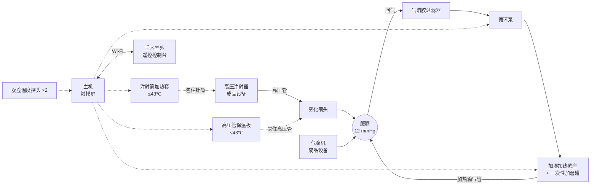

[← 回到总览](../README.md) · [总览](../README.md) · [下一步:采购 →](../2-purchase/README.md)

# 第 1 步 · 方案设计

设计方案 v0.2 · hPIPAC 前端加热系统 · 供外科临床讨论与样机试制

PIPAC(腹腔加压气溶胶化疗)在腹腔镜下建立约 12 mmHg 的 CO₂ 气腹,用高压注射器把化疗药液经雾化喷头喷成气溶胶,停留约 30 分钟后经密闭系统排出。本系统在它的“前端”加两样东西:**药液进喷头之前加热**,以及 **CO₂ 加热加湿并循环**,目标是把腹腔内温度带到 41–43 ℃。

## 先说结论

**加热 CO₂ 是主力,加热药液是配角。** 一次 PIPAC 只喷 150–200 mL 药液,从室温加到 42 ℃ 总共只带进约 17 kJ 热量,而且气溶胶液滴极小,喷出后瞬间就和腹腔里的气体同温。文献里把腹腔升到 39–42 ℃ 的做法都是加热并循环 CO₂。药液加热的作用是不让冷药液在喷射点给腹膜降温。

**药液全程不接触本设备。** 药液在注射器针筒和高压管里,本设备只从外面加热针筒和高压管。高压通路不改动、不增加接头,也没有新的药液接触材料。

**药液通路上所有加热面不超过 43 ℃。** 这样无论流速多少、停多久,药液都不可能超过 43 ℃。独立硬件保护在 45 ℃ 切断。

**循环泵前面必须有过滤器,喷雾时泵必须停。** 抽出的气体带化疗药气溶胶,先过滤再进泵和加湿器;喷雾阶段停泵,不把气溶胶抽走。

**主机不控制高压注射器和气腹机。** 这两台是有注册证的成品设备,按它们自己的流程操作。本系统只加热、监测、计时、报警。

**现在做出来的只能是样机。** 你们希望直接用于病人,这一点我在第 9 节单独说明:自制设备接入化疗手术,在取得注册证和伦理批准之前不能用于病人。本方案按临床使用的要求来设计,但交付的是用于台架和动物实验的样机。

## 1. PIPAC 的标准做法

| 项目 | 常见数值 | 说明 |
| --- | --- | --- |
| 气腹压力 | 12 mmHg | CO₂,气腹机维持 |
| 药液 | 顺铂 + 多柔比星,或奥沙利铂 | 各稀释到 50–150 mL,总量约 150–200 mL |
| 注射 | 高压注射器,流速 0.5–0.7 mL/s,压力上限约 150–300 psi | 造影用高压注射器 |
| 雾化 | 高压雾化喷头经 12 mm 穿刺器进腹 | 喷雾约 5–7 分钟 |
| 暴露 | 30 分钟 | 气腹保持不动 |
| 排出 | 经密闭排气系统和两级过滤器排到医院废气系统 | |
| 人员防护 | 腹腔密闭、层流手术室、喷雾和暴露期间人员离开、遥控操作 | 至今没有气溶胶泄漏的严重事件报道 |

上表的数值来自综述和安全共识(见文末),不同中心略有差异,以你们实际使用的喷头和注射器说明书为准。

## 2. 文献里怎么做加热 PIPAC

| 做法 | 谁做的 | 怎么加热 | 结果 |
| --- | --- | --- | --- |
| 加热 CO₂ 闭环循环 | 首尔团队,2024 年猪实验(11 头) | 加热的 CO₂ 在闭合回路里循环,直到腹腔和腹膜表面到 42 ℃;喷雾后继续循环 60 分钟 | 可行、安全;猪的核心体温平均升高约 2.5 ℃ |
| 加热 CO₂(早期) | 首尔团队,2015 年猪实验(5 头) | CO₂ 通过 52 ℃ 热水后升到 37.5 ℃ | 腹腔温度 38.8–40.2 ℃ 维持 1 小时;作者指出 CO₂ 在输送途中很容易散热 |
| 改装加温加湿气腹设备 | 图宾根团队 | 用改装的商用加温加湿气腹设备(Humigard) | 建立了技术平台 |
| 离体药理实验 | 图宾根团队,牛膀胱 | 组织保持 41–43 ℃ | 顺铂和多柔比星的组织浓度、渗透深度**没有**因加热而提高 |
| 热纳米气溶胶(HINAT) | 德国团队,猪 | 在体外生成 41 ℃ 的带电纳米气溶胶 | 报告分布更均匀、渗透更深;但同时改了粒径,不能只归因于温度 |

两点要如实告诉临床:

- **加热是否提高疗效,文献结论不一致。** 离体实验没有看到渗透增加,活体猪实验主要证明了可行和安全。目前没有检索到加热 PIPAC 的临床对照试验。
- **靠气体把腹腔升温很慢,而且会带高核心体温。** 麻醉必须监测核心体温。

## 3. 热量账:为什么这样分工

以下都是我按物性算的估算值,没有做过热仿真,也没有实测。

**药液。** 200 mL 从 22 ℃ 加到 42 ℃ 需要约 17 kJ,相当于 40 W 加热 7 分钟。这点热量和人体每分钟约 6 kJ 的产热相比很小,靠它升不了腹腔温度。

**气溶胶。** 喷头出来的液滴直径是几十微米,热容量极小,毫秒量级就和周围气体同温。所以液滴到达腹膜时的温度基本取决于腹腔里的气体温度。

**CO₂ 气体。** 干燥 CO₂ 几乎不带热:10 L/min、温差 10 ℃ 只有约 2.6 W。加湿后靠水蒸气的潜热,10 L/min 的饱和气从 43 ℃ 降到 38 ℃ 能放出约 7 W。相比之下 HIPEC 用 42 ℃ 的液体灌注,换热在 100 W 以上。所以:

- CO₂ 必须加湿,否则既不带热又会让腹膜干燥。
- 输气管必须全程加热保温,否则到穿刺器时已经凉了。
- 要循环,不能只靠气腹机那点补气流量。
- 预期能达到的是文献报道的 39–42 ℃ 腹腔内气体和表面温度,深部组织到不了这个温度。

**高压管。** 0.5 mL/s 的流速下,药液在 60 cm 保温板里只停留约 3 秒,厚壁高压管传热差,冷药液流过只能升约 7 ℃。所以药液主要靠针筒加热套预热,保温板的作用是:让等待期间停在高压管里的那几毫升药液不凉下来,并补偿管路散热。

## 4. 系统组成

| 部分 | 做什么 | 定制还是外购 |
| --- | --- | --- |
| 注射筒加热套 | 两片半圆壳包住针筒,内贴硅胶加热片,把药液预热并保持在目标温度 | 定制(3D 打印 + 加热片) |
| 高压管保温板 | 两片铝板夹住高压管靠近喷头的一段,保持温度 | 定制(CNC 铝板 + 打印外壳) |
| 加湿加热底座 | 铝盘加热一次性加湿罐里的无菌水,CO₂ 流过后升温加湿 | 底座定制;加湿罐外购一次性耗材 |
| 加热输气管 | 管壁带加热丝,把气体保温送到穿刺器 | 外购一次性耗材 |
| 循环泵和过滤器 | 把腹腔气体抽出、过滤后送回加湿罐 | 外购 |
| 腹腔温度探头 | 两只,经穿刺器放进腹腔不同位置 | 外购 |
| 主机 | ESP32 安全主控 + 7 英寸触摸屏,四路加热、泵、报警 | 定制 |
| 遥控控制台 | 手术室外电脑上的网页:温度曲线、阶段、计时、报警、操作 | 软件 |

固件、服务器、页面之间的字段和规则见[接口约定](interface-spec.md)。

## 5. 手术流程

| 阶段 | 人做什么 | 设备做什么 |
| --- | --- | --- |
| 预热 | 装药、装管路、建立气腹、放温度探头、接循环回路 | 四路加热升温;循环加热的 CO₂ 给腹腔升温 |
| 就绪 | 确认各项到温,人员准备离开 | 保持 |
| 喷雾 | 在室外启动高压注射器 | 停循环泵;针筒和高压管继续保温 |
| 暴露 | 室外等待,看控制台 | 计时 30 分钟;药液加热关;气体侧保持;默认不循环 |
| 排气 | 经密闭排气系统排空气腹 | 全部关闭 |

暴露阶段要不要循环是一个没有定论的选择:循环能维持温度,但气体经过过滤器会把气溶胶滤掉。默认不循环,控制台上可以改,这需要实验来决定。

## 6. 四路加热

| 通路 | 功率 | 控制 | 保护 |
| --- | --- | --- | --- |
| 注射筒加热套 | 24 V 40 W 硅胶加热片 | 两只测温,套温不超过 43.0 ℃ | 程序 43.8 ℃ 锁定;独立温控器 45 ℃;温控开关 50 ℃ |
| 高压管保温板 | 24 V 30 W 薄膜加热片 | 两只测温,板温不超过 43.0 ℃ | 同上;合盖检测 |
| 加湿加热底座 | 24 V 120 W 硅胶加热片 | 按罐出口气温控制,目标温度 + 1 ℃ | 底座 85 ℃ 上限;出口气温 46 ℃ 锁定;缺水判断;温控开关 95 ℃ |
| 加热输气管 | 24 V 约 30 W(耗材自带加热丝) | 按病人端气温控制 | 病人端 44.5 ℃ 锁定 |

- 针筒从室温预热到 42 ℃ 估计要 35–40 分钟。更快的办法是配好的药先放 42 ℃ 温箱,加热套只负责保温。
- 所有加热电流都要先过独立的硬件保护再过程序控制的开关,任何一道断开加热即停。

## 7. 安全设计

**对药液。** 加热面不超过 43 ℃;药液不接触设备;高压通路不改动。顺铂会和铝反应,所以铝板只接触高压管外壁,绝不接触药液。

**对病人。** 腹腔内任一探头到 43.5 ℃,四路加热和循环泵全停。循环回路上测压,超过 18 mmHg 或低于 6 mmHg 停泵。核心体温由麻醉监护,本设备不测。

**对人员(化疗药气溶胶)。** 回气先过气溶胶过滤器再进泵,泵和加湿罐不接触药。回路全部用一次性耗材,用后按细胞毒性废物处理。喷雾阶段停泵。循环回路增加了接头数量,也就增加了泄漏点,这是本方案相对标准 PIPAC 多出来的主要风险,必须做密闭性测试。

**对无菌。** 进腹的气体经过的加湿罐、输气管、过滤器都是无菌一次性耗材。针筒加热套和高压管保温板在无菌区外或用无菌套包住。

**断电和死机。** 加热和泵全停。气腹机独立工作,气腹不受影响。

**遥控。** 喷雾和暴露期间人员在室外,通过控制台查看和操作。主机上的中止键、指示灯、蜂鸣器直接接安全主控,不依赖网络和触摸屏。

## 8. 还不知道、要靠实验回答的

- 循环加热 CO₂ 到底能把腹腔带到多少度、要多久。文献是 39–42 ℃,本系统的流量和功率下是多少要实测。
- 暴露阶段循环会滤掉多少气溶胶。
- 循环回路的密闭性,在 12 mmHg 下有没有泄漏。
- 高压管外径和弯曲半径。保温板的槽要按实际高压管加工,硬的编织管可能弯不到 15 mm 半径。
- 注射筒外径。加热套要按实际注射器加工。
- 加湿罐和加热输气管用哪家的耗材,接口是否和穿刺器的鲁尔接头匹配。
- 加热对药效的影响。这是临床研究问题,不是设备能回答的。

## 9. 关于“直接用于病人”

你们选的使用阶段是直接用于病人。我的判断是现在不行,理由是:

- 这是一台接入化疗手术、给腹腔加热的有源设备,在中国按医疗器械管理,需要注册检验、临床评价和注册证。循环回路还涉及细胞毒性气溶胶的密闭,风险等级不低。
- 样机用的是开发板、通用电源和 3D 打印件,没有做过电气安全、电磁兼容、生物相容性和灭菌验证。
- 加热 PIPAC 本身还在研究阶段,用于病人属于临床研究,需要伦理委员会批准。

可行的路线是:台架实验(用水和模型腹腔)→ 离体组织 → 动物实验 → 和有资质的医疗器械企业合作做注册样机 → 伦理批准下的临床研究。本仓库交付的是这条路线的第一步。

## 参考资料

1. [Research progress in techniques related to PIPAC(综述,2025)](https://link.springer.com/article/10.1007/s44178-025-00190-4)
2. [Technology development of hyperthermic PIPAC (hPIPAC)](https://www.ncbi.nlm.nih.gov/pmc/articles/PMC8523399/)
3. [Feasibility of hyperthermic pressurized intraperitoneal aerosol chemotherapy in a porcine model(2015)](https://link.springer.com/article/10.1007/s00464-015-4738-0)
4. [首尔团队 HPIPAC 系统猪实验(Surgical Endoscopy 2024)](https://doi.org/10.1007/s00464-024-10702-4)
5. [hPIPAC 离体药理实验(图宾根)](https://publikationen.uni-tuebingen.de/xmlui/handle/10900/136670)
6. [Hyperthermic intracavitary nanoaerosol therapy (HINAT)](https://www.ncbi.nlm.nih.gov/pmc/articles/PMC5753046/)
7. [Advancements in nebulizers for PIPAC](https://www.degruyterbrill.com/document/doi/10.1515/pp-2025-0008/html)
8. [PIPAC: Occupational Health and Safety Aspects](https://www.ncbi.nlm.nih.gov/pmc/articles/PMC3764316/)
9. [Consensus statement on safety measures for PIPAC](https://www.ncbi.nlm.nih.gov/pmc/articles/PMC8719448/)
10. [PIPAC 系统综述(IDEAL 框架)](https://www.ncbi.nlm.nih.gov/pmc/articles/PMC10364525/)

这些文献我只读到了摘要和检索摘录,没有读全文。表里的具体数值请对照原文核实后再引用。

---

[← 回到总览](../README.md) · [总览](../README.md) · [下一步:采购 →](../2-purchase/README.md)
