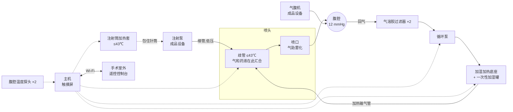

[← 回到总览](../README.md) · [总览](../README.md) · [下一步:采购 →](../2-purchase/README.md)

# 第 1 步 · 方案设计

设计方案 v0.3 · hPIPAC 气助加热雾化系统 · 供外科临床讨论与样机试制

PIPAC(腹腔加压气溶胶化疗)在腹腔镜下建立约 12 mmHg 的 CO₂ 气腹,把化疗药液喷成气溶胶,停留约 30 分钟后经密闭系统排出。本方案的核心是一只**气助加热雾化喷头**:把循环加热加湿的 CO₂ 当作雾化气,在喷头里和药液汇合,药雾生成时就在 42 ℃ 的饱和气流里。

## 先说结论

**加热和雾化合在喷头上。** 温热加湿的 CO₂ 从喷头的环形气隙高速喷出,把中心毛细管里流出的药液撕成雾。同一股气流既是雾化气,又是给腹腔送热的载体,还顺带搅动腹腔里的气体。

**为什么这样选。** 文献里 PIPAC 最明确的两个短板是药物分布不均匀,以及想加热时热量送不进去。只加热药液没有用(雾滴太小,瞬间和气体同温),真正起作用的是气体。既然必须循环一股热气,就让这股气顺便完成雾化和搅拌,一个部件解决三件事。

**不再需要高压注射器。** 气助雾化靠的是气流速度,药液只需要普通注射泵的低压推注。标准 PIPAC 里那条 10–20 bar 的化疗药高压管路没有了,高压爆管这个风险随之消失。

**药液只接触毛细管。** 药液从注射泵针筒经细管进喷头中心的不锈钢毛细管,直接到喷口。喷头的其他零件只接触气体。

**所有靠近药液的加热面不超过 43 ℃。**

**这是一个需要实验来证明的设想,不是已经验证的结论。** 雾滴有多细、分布是否更均匀、有多少药被回气带走,我只有估算。第 8 节列出了必须先回答的问题。它是否新颖我也无法保证,文献里已有“加热 CO₂ 闭环循环”和“双流体喷头”的报道,申请专利或发表之前需要做正式的查新。

**现在做出来的只能是样机。** 你们希望直接用于病人,第 9 节说明为什么现在不行、路线是什么。

## 1. PIPAC 的标准做法

| 项目 | 常见数值 | 说明 |
| --- | --- | --- |
| 气腹压力 | 12 mmHg | CO₂,气腹机维持 |
| 药液 | 顺铂 + 多柔比星,或奥沙利铂 | 各稀释到 50–150 mL,总量约 150–200 mL |
| 注射 | 高压注射器,流速 0.5–0.7 mL/s,压力上限约 150–300 psi | 造影用高压注射器 |
| 雾化 | 单流体高压喷头经 12 mm 穿刺器进腹 | 喷雾约 5–7 分钟 |
| 暴露 | 30 分钟 | 气腹保持不动 |
| 排出 | 经密闭排气系统和两级过滤器排到医院废气系统 | |
| 人员防护 | 腹腔密闭、层流手术室、喷雾和暴露期间人员离开、遥控操作 | |

上表数值来自综述和安全共识(见文末),不同中心略有差异。

## 2. 文献里的加热 PIPAC 和喷头改进

| 做法 | 谁做的 | 要点 | 结果 |
| --- | --- | --- | --- |
| 加热 CO₂ 闭环循环 | 首尔团队,2024 年猪实验(11 头) | 加热的 CO₂ 在闭合回路里循环,直到腹腔和腹膜表面到 42 ℃ | 可行、安全;核心体温平均升约 2.5 ℃ |
| 加热 CO₂(早期) | 首尔团队,2015 年猪实验 | CO₂ 通过 52 ℃ 热水后升到 37.5 ℃ | 腹腔 38.8–40.2 ℃;CO₂ 在输送途中很容易散热 |
| 离体药理实验 | 图宾根团队,牛膀胱 | 组织保持 41–43 ℃ | 药物组织浓度和渗透深度**没有**因加热而提高 |
| 热纳米气溶胶(HINAT) | 德国团队,猪 | 体外生成 41 ℃ 的带电纳米气溶胶 | 报告分布更均匀、渗透更深 |
| 喷头综述 | 多个团队 | 现有单流体喷头雾滴偏大,大部分药落在喷头正对面 | 分布不均匀是公认的短板 |

如实告诉临床的两点:

- **加热是否提高疗效,文献结论不一致。** 目前没有检索到加热 PIPAC 的临床对照试验。
- **靠气体把腹腔升温很慢,而且会带高核心体温。** 麻醉必须监测核心体温。

## 3. 原理和估算

以下都是按物性和经验公式算的估算值,没有做过仿真,也没有实测。

**气助雾化。** 药液从外径 1.6 mm 的毛细管流出,周围是喷口直径 2.0 mm 的环形气隙,面积约 1.1 mm²。12 L/min 的气体通过时流速约 180 m/s,气压约 50–80 kPa。高速气流把液体撕碎。按经验公式(Nukiyama–Tanasawa)粗估:

| 药液流速 | 气流量 | 估算平均雾滴直径 |
| --- | --- | --- |
| 0.1 mL/s | 12 L/min | 约 30–40 µm |
| 0.05 mL/s | 12 L/min | 约 30 µm |
| 0.1 mL/s | 15 L/min | 约 25–30 µm |

这和现有高压喷头大致相当或略细,不是数量级的改进。这个公式本身很粗,实际粒径必须实测。好处主要不在粒径,而在:药液压力从十几 bar 降到 1 bar 以下;雾出生在温热饱和的气流里;气流带着雾走,并搅动腹腔。

**喷雾时间变长。** 气量有限,药液流速只能到 0.05–0.1 mL/s,是标准 PIPAC 的五分之一到十分之一。100 mL 药液要喷 17–33 分钟。药液总量应尽量浓缩到 100 mL 以内。

**为什么 CO₂ 必须加湿。** 干燥 CO₂ 几乎不带热(10 L/min、温差 10 ℃ 只有约 2.6 W),还会让雾滴蒸发降温、让腹膜干燥。加湿后靠水蒸气潜热,10 L/min 的饱和气从 43 ℃ 降到 38 ℃ 能放出约 7 W。

**能升到多少度。** 这点热量和 HIPEC 的液体灌注(100 W 以上)相比很小。预期能达到的是文献报道的 39–42 ℃ 腹腔内气体和表面温度,深部组织到不了。

**药液在喷头里被加热。** 毛细管有约 250 mm 走在温热的气流中心,0.1 mL/s 的药液在里面停留约 2 秒,不锈钢薄壁传热好,估算出口药液温度接近气温。注射筒加热套做预热,让它不必全靠这一段。

**最大的未知数:被回气带走的药。** 进多少气就要出多少气。回气口抽走的气体里带着药雾,被过滤器拦下,这部分药没有到腹膜上。回气口离喷头越远、雾滴沉降越快,损失越小,但具体是百分之几还是百分之几十,我算不出来,必须称过滤器的增重来实测。

## 4. 系统组成

| 部分 | 做什么 | 定制还是外购 |
| --- | --- | --- |
| 气助加热雾化喷头 | 喷嘴头、定心旋流片、喷头杆、毛细管、歧管 | 定制(本项目的核心) |
| 注射筒加热套 | 两片半圆壳包住注射泵的针筒,预热药液 | 定制 |
| 加湿加热底座 | 铝盘加热一次性加湿罐里的无菌水 | 底座定制;加湿罐外购 |
| 加热输气管 | 把气体保温送到喷头歧管 | 外购一次性耗材 |
| 循环泵和过滤器 | 把腹腔气体抽出、过滤、加压送回。喷雾时它就是雾化气源 | 外购 |
| 腹腔温度探头、压力传感器 | 两只温度探头;腹腔压力;喷头处的雾化气压 | 外购 |
| 主机 | ESP32 安全主控 + 7 英寸触摸屏 | 定制 |
| 遥控控制台 | 手术室外电脑上的网页 | 软件 |

固件、服务器、页面之间的字段和规则见[接口约定](interface-spec.md)。

## 5. 喷头的结构

喷头杆是一根外径 10 mm 的不锈钢管,经 12 mm 穿刺器进腹,喷口伸进腹腔约 40 mm。

| 零件 | 作用 |
| --- | --- |
| 喷嘴头 | 压进喷头杆下端。内腔收缩到直径 2.0 mm 的喷口 |
| 药液毛细管 | 外径 1.6 mm、内径 1.0 mm 的不锈钢管,从歧管顶部一直穿到喷口,末端伸出喷口 0.5 mm。药液只在它里面 |
| 定心旋流片 | 放在喷嘴头内腔,把毛细管定在正中;三条切向槽让气流旋转,使喷雾锥角更大 |
| 喷头杆 | 毛细管和杆壁之间是气体通道 |
| 歧管 | 留在体外的铝块。喷头杆从下面插入,温热的 CO₂ 从侧面进,毛细管从顶上穿出;背面贴加热片保持 ≤43 ℃;侧面有测压口 |

在三维查看器里打开“气助雾化喷头装配”,点“剖切”能看到内部。

喷口和毛细管的同轴度是关键:气隙只有 0.2 mm,偏心会让雾偏向一边。喷嘴头和旋流片是精密小件,图纸上给了同轴度要求。

## 6. 手术流程

| 阶段 | 人做什么 | 设备做什么 |
| --- | --- | --- |
| 预热 | 装药、装喷头和回路、建立气腹、放温度探头 | 四路加热升温;气腹建立后循环热气给腹腔升温 |
| 就绪 | 确认各项到温,人员准备离开 | 保持 |
| 喷雾 | 在室外启动注射泵 | 循环泵按雾化气流量运转;四路加热保持 |
| 暴露 | 室外等待,看控制台 | 计时 30 分钟;药液侧加热关;默认不循环 |
| 排气 | 经密闭排气系统排空气腹 | 全部关闭 |

暴露阶段要不要继续循环没有定论:循环能维持温度,但会把还悬浮着的药雾滤掉。默认不循环,控制台上可以改。

## 7. 安全设计

**对药液。** 注射筒加热套和喷头歧管的加热面不超过 43 ℃,程序在 43.8 ℃ 锁定,独立硬件保护在 45 ℃ 切断。药液只接触针筒、细管和不锈钢毛细管。顺铂会和铝反应,铝件只接触气体。

**对病人。** 腹腔内任一探头到 43.5 ℃,四路加热和循环泵全停。腹腔压力超过 18 mmHg 或低于 6 mmHg 停泵。喷头气压超过 150 kPa(喷嘴堵了)停泵。高速气流直吹腹膜是否造成损伤是未知的,喷口到组织的最小距离要靠实验确定。核心体温由麻醉监护。

**对人员。** 回气先过两级气溶胶过滤器再进泵。回路全部用一次性耗材,用后按细胞毒性废物处理。循环回路比标准 PIPAC 多出若干接头,而且泵后的一段带正压(几十 kPa),这一段虽然是过滤后的气体,仍必须做密闭性测试。

**对无菌。** 喷头进入腹腔,必须能灭菌;毛细管细长,清洗困难,成品应做成一次性。加湿罐、输气管、过滤器用无菌一次性耗材。

**断电和死机。** 加热和泵全停,雾化随之停止。气腹机独立工作,气腹不受影响。

**遥控。** 喷雾和暴露期间人员在室外,通过控制台查看和操作。主机上的中止键、指示灯、蜂鸣器直接接安全主控,不依赖网络和触摸屏。

## 8. 必须先用实验回答的问题

| 问题 | 怎么测 | 对应测试 |
| --- | --- | --- |
| 雾滴到底多大 | 激光粒度仪或落在油膜上显微测量 | T7 |
| 喷雾锥角和分布 | 在模型腹腔内壁贴试纸,喷染料 | T8 |
| 被回气带走多少药 | 喷已知量的盐水,称过滤器增重 | T9 |
| 腹腔能升到多少度、要多久 | 模型腹腔多点测温 | T17 |
| 回路是否密闭 | 保压和检漏 | T15 |
| 气流直吹会不会伤腹膜 | 离体组织,不同距离 | 台架之后 |
| 加热对药效的影响 | 临床研究问题,设备回答不了 | — |

如果 T9 测出来损失很大,这个方案就要改,比如改成间歇喷雾(喷的时候不回气,压力升到上限就停)。

## 9. 关于“直接用于病人”

你们选的使用阶段是直接用于病人。我的判断是现在不行:

- 这是一只进入腹腔、输送化疗药的全新喷头,加上一套有源加热循环设备,在中国按第三类医疗器械管理,需要注册检验、临床评价和注册证。
- 样机用的是开发板、通用电源和 3D 打印件,没有做过电气安全、电磁兼容、生物相容性和灭菌验证。
- 喷头的雾化性能、药物损失、对组织的影响都还没有任何数据。
- 加热 PIPAC 本身还在研究阶段,用于病人属于临床研究,需要伦理委员会批准。

可行的路线:台架实验(用水和模型腹腔)→ 离体组织 → 动物实验 → 和有资质的医疗器械企业合作做注册样机 → 伦理批准下的临床研究。本仓库交付的是第一步。

## 参考资料

1. [Research progress in techniques related to PIPAC(综述,2025)](https://link.springer.com/article/10.1007/s44178-025-00190-4)
2. [Technology development of hyperthermic PIPAC (hPIPAC)](https://www.ncbi.nlm.nih.gov/pmc/articles/PMC8523399/)
3. [Feasibility of hyperthermic pressurized intraperitoneal aerosol chemotherapy in a porcine model(2015)](https://link.springer.com/article/10.1007/s00464-015-4738-0)
4. [首尔团队 HPIPAC 系统猪实验(Surgical Endoscopy 2024)](https://doi.org/10.1007/s00464-024-10702-4)
5. [hPIPAC 离体药理实验(图宾根)](https://publikationen.uni-tuebingen.de/xmlui/handle/10900/136670)
6. [Hyperthermic intracavitary nanoaerosol therapy (HINAT)](https://www.ncbi.nlm.nih.gov/pmc/articles/PMC5753046/)
7. [Advancements in nebulizers for PIPAC](https://www.degruyterbrill.com/document/doi/10.1515/pp-2025-0008/html)
8. [PIPAC: Occupational Health and Safety Aspects](https://www.ncbi.nlm.nih.gov/pmc/articles/PMC3764316/)
9. [Consensus statement on safety measures for PIPAC](https://www.ncbi.nlm.nih.gov/pmc/articles/PMC8719448/)
10. [PIPAC 系统综述(IDEAL 框架)](https://www.ncbi.nlm.nih.gov/pmc/articles/PMC10364525/)

这些文献我只读到了摘要和检索摘录,没有读全文。表里的具体数值请对照原文核实后再引用。

---

[← 回到总览](../README.md) · [总览](../README.md) · [下一步:采购 →](../2-purchase/README.md)
