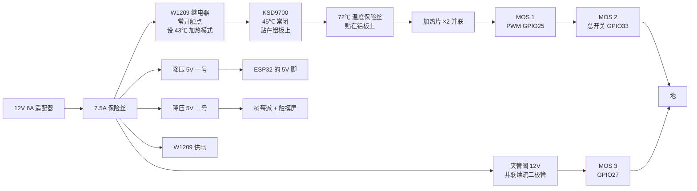

[← 上一步:结构件](../3-mechanical/README.md) · [总览](../README.md) · [下一步:固件 →](../5-firmware/README.md)

# 第 4 步 · 接线

没有定制电路板,用开发板和现成模块按下面的接线表搭。引脚定义和固件里的 [config.h](../5-firmware/include/config.h) 一致,改了一边要同时改另一边。

## 电源与加热回路

加热电流要依次通过四道关卡才能到加热片:W1209(独立电子保护,43 ℃ 断开,自身断电也断开)、KSD9700(机械保护)、温度保险丝(一次性)、两只由程序控制的 MOS 管。任何一道断开,加热即停。

## 信号接线表

| ESP32 引脚 | 接到 | 说明 |
| --- | --- | --- |
| 3V3 | ADS1115 VDD、HX711 VCC、所有 NTC 上端、ADS1115 A3 | A3 直接量 3.3 V 电源,用作比例测量基准 |
| GND | 所有模块地、12 V 电源负极 | 必须共地 |
| GPIO21 / 22 | SDA / SCL | ADS1115(地址 0x48,ADDR 接地) |
| ADS A0 | 板温 NTC 1(控制)分压点 | 每路:3.3 V — NTC — 分压点 — 10 kΩ 0.1% — 地。分压点对地并 100 nF |
| ADS A1 | 板温 NTC 2(保护)分压点 |
| ADS A2 | 出口管壁 NTC 分压点 |
| GPIO36 | 环境 NTC 分压点 | 同样的分压接法。探头放在药袋附近 |
| GPIO16 / 17 | HX711 DT / SCK | 称重传感器四线接 HX711 的 E+ E− A+ A− |
| GPIO26 | 150 Ω → 红外发射管正极,负极接地 | 约 13 mA |
| GPIO34 | 光电三极管集电极;集电极另经 10 kΩ 上拉到 3.3 V,发射极接地 | 发射管和接收管在滴斗夹里正对 |
| GPIO25 | MOS 1 信号 | 加热 PWM。栅极对地 10 kΩ 下拉(模块一般自带) |
| GPIO33 | MOS 2 信号 | 加热总开关 |
| GPIO27 | MOS 3 信号 | 夹管阀。通电打开,断电夹闭 |
| GPIO14 | 蜂鸣器模块信号 |  |
| GPIO18 / 23 / 19 | 红 / 黄 / 绿 LED,各串 330 Ω 到地 |  |
| GPIO32 | 暂停键,另一端接地 | 输液中按一下暂停,暂停时按一下恢复,完成后按一下结束 |
| GPIO13 | 消音键,另一端接地 |  |
| GPIO35 | 干簧管一端,另一端接地;GPIO35 经 10 kΩ 上拉到 3.3 V | 磁铁装在上壳。不装时把 config.h 里 HAS_LID_SWITCH 设 0 |

**触摸屏和树莓派:** 树莓派用第二个 5 V 降压模块单独供电(接 5V 和 GND 脚,或 USB-C 口),触摸屏用 DSI 排线接树莓派,屏的 5 V 和 GND 用附带的杜邦线接树莓派的 5V、GND 脚。树莓派和 ESP32 之间不接线,两者都连同一个 Wi-Fi,通过服务器交换数据。单机测试时也可以把 `server.py` 直接跑在这块树莓派上,ESP32 的 `SERVER_URL` 填树莓派的地址。

## 加温模块 8 芯线缆

加热正、加热负(各用 2 芯并联也可以,电流 2.5 A);NTC 1、NTC 2、出口 NTC 各 1 芯 + 公共 3.3 V 1 芯;干簧管 1 芯 + 地 1 芯。W1209 的探头单独走线插进上板的测温孔。KSD9700 和温度保险丝贴在下板外侧,串在加热正线里。

> 两只板温 NTC 插进下板的两个测温孔,孔里填导热硅脂,孔口点胶固定。这两只读数相差超过 1.5 ℃ 程序会判传感器故障,所以两只都要插到底。

---

[← 上一步:结构件](../3-mechanical/README.md) · [总览](../README.md) · [下一步:固件 →](../5-firmware/README.md)
