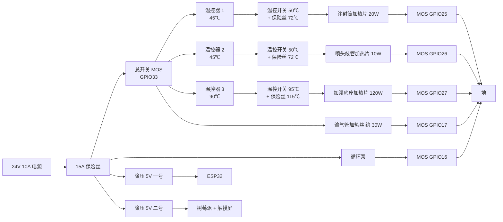

[← 上一步:结构件](../3-mechanical/README.md) · [总览](../README.md) · [下一步:固件 →](../5-firmware/README.md)

# 第 4 步 · 接线

没有定制电路板,用开发板和现成模块按下面的图和表搭。引脚定义和固件里的 [config.h](../5-firmware/include/config.h) 一致,改了一边要同时改另一边。这份接线没有在实物上验证过,第一次上电不要接加热片和泵,先做[第 7 步](../7-testing/README.md)的 T1–T3。

## 电源和保护回路

每一路加热电流都要依次通过:总开关(程序控制)、独立温控器(自己带探头和继电器,不经过程序)、机械温控开关和温度保险丝(贴在加热面上)、本路的开关(程序控制)。任何一道断开,这一路就停。

- 温控器、温控开关、保险丝的探头或本体要贴在各自的加热面上:注射筒加热片外侧、喷头歧管侧面、加湿铝盘底面。
- 输气管的加热丝在一次性耗材里,没有地方装独立保护,靠喷头端气温探头和程序保护。这是四路里保护最弱的一路。
- 每个 MOS 模块的栅极和总开关的控制线都要对地接 10 kΩ 下拉电阻(多数模块自带),保证 ESP32 复位期间输出是关的。
- 循环泵的功率比加热片大的话(小型压缩机可到 60–100 W),电源和导线按实际电流选,总电流留 30% 余量。

## ESP32 引脚

| 功能 | 引脚 | 说明 |
| --- | --- | --- |
| I2C SDA / SCL | GPIO21 / 22 | 三块 ADS1115 |
| 注射筒加热 | GPIO25 | 接 MOS 模块信号端,高电平加热 |
| 喷头歧管加热 | GPIO26 | 同上 |
| 加湿底座加热 | GPIO27 | 同上 |
| 输气管加热 | GPIO17 | 同上 |
| 加热总开关 | GPIO33 | 串在四路加热的电源上,高电平接通 |
| 循环泵 | GPIO16 | 接 MOS 模块信号端,调速 |
| 蜂鸣器 | GPIO4 | 有源蜂鸣器模块 |
| 红 / 黄 / 绿指示灯 | GPIO18 / 23 / 19 | 各串 330 Ω 到地 |
| 中止键 | GPIO32 | 另一端接地 |
| 消音键 | GPIO13 | 另一端接地 |
| 3V3、GND | — | 给三块 ADS1115 和所有测温分压供电;所有模块共地 |

## 测温和测压

每只热敏电阻的接法相同:3.3 V — 热敏电阻 — 分压点 — 10 kΩ 0.1% — 地,分压点对地并 100 nF,分压点接下表的输入。

| 模块 | 地址 | 地址脚接 | A0 | A1 | A2 | A3 |
| --- | --- | --- | --- | --- | --- | --- |
| ADS1115 一号 | 0x48 | 地 | 注射筒套 1 | 喷头歧管 1 | 加湿罐出口气温 | 3.3 V(基准) |
| ADS1115 二号 | 0x49 | 3.3 V | 注射筒套 2 | 喷头歧管 2 | 加湿底座 | 输气管喷头端气温 |
| ADS1115 三号 | 0x4A | SDA | 雾化气压传感器 | 腹腔探头 1 | 腹腔探头 2 | 腹腔压力传感器 |

- 每一对探头(注射筒套 1 和 2、喷头歧管 1 和 2)分别接在两块模块上。一块模块出错时两只读数会对不上,程序判传感器故障。
- 两只压力传感器输出都是 0.5–4.5 V,各经 10 kΩ(上)和 20 kΩ(下)分压后接三号的 A0 和 A3。雾化气压传感器量程 0–200 kPa,接在喷头歧管的测压口;腹腔压力传感器量程 0–50 mmHg,接在回气管路靠近穿刺器的一端。
- 腹腔探头如果不是 10 kΩ 的型号,分压电阻和 config.h 里的参数要按探头改。
- 腹腔探头的线进入无菌区和病人体内。样机阶段只在模型腹腔上用;用于动物或人之前,探头必须是有注册证的医用探头,电路要做病人隔离,这一版没有做。

## 触摸屏和树莓派

树莓派用二号 5 V 降压模块单独供电,触摸屏用排线接树莓派。树莓派运行盒内服务程序,并开一个只供盒内用的 Wi-Fi 热点;ESP32 连这个热点,把数据报给树莓派,触摸屏显示。两者之间不接线,也都不接医院网络。热点的设置见[第 6 步](../6-software/README.md)。

## 接插件

主控盒侧面 7 个航空插座,从左到右:电源、注射筒套、喷头歧管、加湿底座、输气管(以上 GX16)、循环泵、腹腔探头和压力(以上 GX12)。每根线缆里加热线和测温线分开走,测温线用屏蔽线。

## 喷雾时停泵怎么办

喷雾阶段循环泵就是雾化气源。任何报警让泵停下时,雾化随之停止,而注射泵不归本机控制,还在推药,药液会不成雾直接滴进腹腔。这时触摸屏会提示**立即停止注射泵**,红灯快闪,蜂鸣器急响。

成品应当加一路联锁:本机给注射泵一个停止信号,或者在药液细管上加一只常闭夹管阀,泵停则药停。这一版没有做。

---

[← 上一步:结构件](../3-mechanical/README.md) · [总览](../README.md) · [下一步:固件 →](../5-firmware/README.md)
