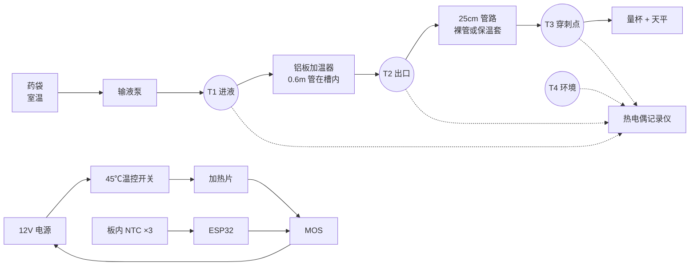

[← 回到第 7 步:分步测试](../README.md) · [总览](../../README.md)

试验规程 v0.1 · 2026-11-12 · 输液加温监控一体机 · 阶段 A

# 加温台架试验方案

目的是用实测回答一个问题:0.6 m 普通输液管夹在 41 ℃ 的铝板里,能不能在病房流速下把 37 ℃ 的药液送到穿刺点。全程用水或生理盐水,不接触病人。

## 1. 要验证的指标

| 编号 | 指标 | 通过标准 | 设计计算值 |
| --- | --- | --- | --- |
| K1 | 换热能力 UA(板温到药液) | ≥0.75 W/K | 0.96 W/K |
| K2 | 500 mL/h、进液 22 ℃、板温 41 ℃ 时的出口温度 | ≥37.0 ℃ | 37.4 ℃ |
| K3 | 60–500 mL/h 闭环控制时,穿刺点温度与设定值之差 | ±1.0 ℃ 以内 | — |
| K4 | 任何工况(含停流再启动、单一故障)下药液最高温度 | ≤43.0 ℃ | ≤41 ℃(正常) |
| K5 | 由 22 ℃ 预热到板温 40 ℃ 的时间 | ≤5 分钟 | 台架板约 4 分钟 |
| K6 | 管路夹入槽内后,重力滴速的变化 | 下降 ≤5% | — |
| K7 | 保温外壳表面最高温度 | ≤41 ℃ | — |

K1 不达标时的处理顺序:先加垫片调整夹紧量改善贴合,再加长槽(板加长到 260 mm,管长约 0.78 m),最后才考虑提高板温上限。

## 2. 铝板加工

上下两片,镜像对称。材料 6061-T6,台架阶段可以不做阳极氧化。每片 200 × 64 × 6 mm。

槽中心线总长 603 mm:直段 182 + 164 + 182,两个 R12 半圆各 37.7。

| 特征 | 尺寸与要求 |
| --- | --- |
| 槽 | R2.0 球头铣刀沿中心线铣,每片深 1.95 mm。合模后孔为 4.0 × 3.9 mm,对外径 4.1 mm 的管有约 0.1–0.2 mm 的轻微压缩。槽口倒角 C0.2,去毛刺,槽面粗糙度 Ra ≤1.6 |
| 夹紧螺丝 | 4×M3,位置 (60, 20)、(140, 20)、(60, 44)、(140, 44),都在两条直槽中间。上板 Ø3.4 通孔,下板 M3 攻丝 |
| 定位销 | 2×Ø3,位置 (192, 60)、(8, 4) |
| 测温孔 | 下板 2 个,从 y=0 的长边向内钻 Ø2.2 深 20,位置 x=97 和 x=107,孔中心距槽面 4 mm(即不与槽相通)。上板同位置 1 个,用来看上下板温差 |
| 垫片 | 另备 0.1 mm 和 0.2 mm 不锈钢垫片各 4 片,套在螺丝上调节夹紧量 |

> 加工前先用卡尺量你们医院常用输液器的管外径,至少量 3 个品牌各 5 根。如果普遍小于 3.9 mm 或大于 4.2 mm,把槽深相应改掉再下单。这一步我无法替你们确认。

台架板每片 6 mm,两片共约 415 g,比产品重,是为了加工方便和测温孔好钻。产品阶段会减薄到 4 mm 并掏减重槽。

## 3. 器材清单

| 用途 | 器材 | 要求 |
| --- | --- | --- |
| 加热 | 聚酰亚胺薄膜加热片 ×2 | 12 V 15 W,约 50 × 150 mm,带背胶,贴在两片铝板外侧 |
| 保温 | 10 mm 闭孔泡棉或气凝胶毡 | 包住两片板的外侧和四周 |
| 过温保护 | KSD9700 常闭温控开关 45 ℃ | 贴在铝板上,串在加热回路里。台架必须装 |
| 电源 | 12 V 5 A 直流电源 | 带限流更好 |
| 控制 | ESP32 开发板、N 沟道 MOS 模块、10 kΩ NTC(B3950,1%)×3、10 kΩ 0.1% 电阻 ×3 | 程序见第 8 节 |
| 供液 | 病房输液泵 + 配套输液器 | 用来给出 60–1000 mL/h 的准确流量。没有泵时用重力 + 滚轮夹,用天平称出液算流量 |
| 液体 | 500 mL 生理盐水或蒸馏水若干袋 | 提前在试验房间放 4 小时以上,与室温一致 |
| 测液温 | T 型细丝热电偶(线径 ≤0.25 mm)×4,三通接头 ×3,多通道热电偶记录仪 | 热电偶探头从三通侧口伸入液流中心,用热熔胶封口。记录间隔 1 秒 |
| 校准 | 经计量的精密温度计(±0.1 ℃),保温杯 | 冰水和 37 ℃、41 ℃ 温水三点校准 |
| 称量 | 电子天平,量程 ≥600 g,分度 0.1 g | 核对实际流量 |
| 其他 | 秒表、红外测温枪或贴片热电偶、25 cm 保温套(闭孔泡棉管,内径 4–5 mm) |  |

## 4. 台架连接

- T2 的三通紧贴铝板出口,距板边不超过 2 cm。T3 在 T2 之后 25 cm 管长处。
- 三个三通都用泡棉包住,否则低流速时接头自身散热会让读数偏低。
- 加温器平放在木板或泡棉上,不要放在金属桌面上。避开空调出风口。
- 出液口高度与病床上前臂高度相近,量杯放在天平上。

## 5. 试验步骤

稳态的判定:T2 在 2 分钟内变化小于 0.1 ℃,且已至少流过 3 倍槽内容积(槽内容积约 4.2 mL)。60 mL/h 时每个工况至少等 15 分钟。

| 编号 | 内容 | 做法 | 记录 |
| --- | --- | --- | --- |
| S0 | 传感器校准 | 全部热电偶和 NTC 捆在一起,依次放入冰水、37 ℃、41 ℃ 水中,与精密温度计比对,记下各点偏差并在后续数据中修正 | 每只传感器三点偏差 |
| S1 | 预热与均匀性 | 管内充满水但不流动,板温设 41 ℃,从冷态开始加热 | 到 40 ℃ 的时间;稳定后三只 NTC 的差值;过冲量 |
| S2 | 稳态换热(核心) | 板温固定 41 ℃。流量依次 60、120、250、500、750、1000 mL/h,每档到稳态后记录 2 分钟平均值。整组重复 3 遍 | T1、T2、T3、T4、板温、加热占空比、天平称得的实际流量 |
| S3 | 下游散热 | 在 S2 的 60、120、250 三档,把 T2 之后的管路分别换成:25 cm 裸管、25 cm 加保温套、100 cm 裸管 | T2 与 T3 之差 |
| S4 | 闭环控温 | 程序切到“目标温度”模式,目标 37 ℃。流量按 120 → 500 → 60 → 250 阶跃变化,每档保持 15 分钟 | T3 的稳态值、超调量、回到 ±1 ℃ 所需时间 |
| S5 | 停流再启动 | 在 120 和 500 mL/h 稳态时停泵 10 分钟,再恢复原流量 | 恢复后 2 分钟内 T2、T3 的最高值 |
| S6 | 冷药液 | 药袋放冰箱到约 10 ℃(模拟冬天或冷藏药),重复 S2 的 120、250、500 三档 | 同 S2 |
| S7 | 故障注入 | (a) 短接 MOS 让加热片全功率常开,流量 0 和 60 mL/h 各做一次,看 45 ℃ 温控开关动作时板温和 T2 最高到多少。(b) 运行中拔掉控制 NTC。(c) 运行中打开上板 | 板温峰值、T2 峰值、程序是否停止加热 |
| S8 | 管路兼容性 | 不接泵,药袋挂 80 cm 高,滚轮夹全开,先测管路不入槽时 1 分钟出液量,再测入槽合盖后的出液量。3 个品牌的输液器各做一次,并分别加 0、0.1、0.2 mm 垫片 | 出液量变化百分比;拆出后管壁有无压痕、发白 |
| S9 | 气泡 | 用 S6 的冷药液,板温 41 ℃,120 mL/h 运行 30 分钟,目视并拍照出口后的管路 | 气泡数量、大小、是否汇聚成段 |
| S10 | 外表面温度 | 板温 41 ℃ 稳定 30 分钟后,测保温层外表面各处 | 最高点温度 |

> S7(a) 是故意让设备失控的试验。做的时候人不要离开,旁边不放易燃物,温控开关没装好之前不要做。如果板温超过 60 ℃ 仍未断开,立即拔电源。

## 6. 数据处理

每个稳态工况用下面的公式算出 UA,与设计值 0.96 W/K 比较。流量用天平称得的实际值,不用泵的设定值。

`UA = −(Q ÷ 3600 × 4.18) × ln[(T板 − T2) ÷ (T板 − T1)]`,Q 的单位是 mL/h,结果单位 W/K。

> 这里原本是一个换算小工具,公式见上文。

- 低流速(60、120 mL/h)时 T2 会非常接近板温,对数项对测温误差极敏感,这两档算出的 UA 不可靠。UA 以 250、500、750 三档的平均值为准。
- 把 6 档的 T2 画成“出口温度—流量”曲线,和总方案第 4 节的表对照。
- S3 的数据用来修正程序里的下游散热系数(现在的估计值:裸管 0.12 W/K 每米,带保温套 0.04 W/K 每米)。
- 加热功率核对:稳态电功率应略大于 Q ÷ 3600 × 4.18 × (T2 − T1),多出的部分就是外壳散热。

## 7. 记录表

同一份表头已做成 [bench-record-template.csv](bench-record-template.csv),可以直接用 Excel 打开填写。

| 日期 | 试验编号 | 重复 | 输液器品牌 | 垫片 mm | 下游管路 | 设定流量 | 实际流量 | 板温设定 | 板温 NTC1/2/3 | T1 | T2 | T3 | T4 环境 | 占空比 % | 备注 |
| --- | --- | --- | --- | --- | --- | --- | --- | --- | --- | --- | --- | --- | --- | --- | --- |
| 示例 | S2 | 1 | — | 0 | 25 cm 保温套 | 500 |  | 41.0 |  |  |  |  |  |  |  |

## 8. 台架温控程序

文件 [bench_controller.ino](bench_controller.ino),Arduino IDE 里选 ESP32 开发板(arduino-esp32 3.x)即可编译。我没有硬件,这段程序没有实际编译和运行过,第一次上电请先不接加热片,确认串口温度读数正常再接。

- 接线:NTC 一端接 3.3 V,另一端接 ADC 引脚并经 10 kΩ 电阻接地。NTC1(控制)GPIO34,NTC2(保护)GPIO35,NTC3(上板)GPIO32。MOS 栅极 GPIO25。
- 串口 115200。发送 `p41` 把板温固定在 41 ℃(S1–S3、S5–S10 用)。发送 `t37 q120 k0.01` 进入目标温度模式:目标 37 ℃、当前流量 120 mL/h、下游散热 0.01 W/K(S4 用,流量变化时重新发 q)。发送 `x` 停止加热。
- 程序每秒输出一行 CSV:时间、三只 NTC、板温设定、占空比、状态。
- 保护:任一 NTC ≥42.5 ℃、NTC1 与 NTC2 相差 >1.5 ℃、读数超出 0–60 ℃ 时关闭加热并锁定,需重新上电。

## 9. 试验做完后怎么判断

- **K1、K2 达标:** 加温方案成立,进入阶段 B(称重和数滴台架),同时把铝板减薄做成产品形态。
- **UA 在 0.5–0.75 W/K:** 有效流量上限会降到约 250–350 mL/h,病房仍可用。把槽加长到 0.78 m 再测一次。
- **UA 低于 0.5 W/K:** 管壁贴合有问题。检查槽径与管径是否匹配,必要时在槽内垫 0.2 mm 导热硅胶片后重测。
- **S9 出现成段气泡:** 产品必须加出口气泡传感器,并把板温上限降到 40 ℃ 再评估。
- **S8 流量下降超过 5% 或管壁有永久压痕:** 加大槽径 0.1 mm 重新加工。
