# hPIPAC 气助加热雾化喷头 · 功能样机 v0.3

腹腔加压气溶胶化疗(PIPAC)用的加热雾化装置。用循环的温热 CO₂ 当雾化气,在喷头里把药液吹成雾。同一股气流完成三件事:**把药打成雾、把热带进腹腔、搅动腹腔里的气体**。目标是让腹腔在喷药时处于 41–43 ℃。

> **这是台架样机,只用水和模型腹腔测试,不用于病人,不接化疗药。** 喷头的雾化效果、加热效果、药物损失都还没有实测。

## [▶ 打开演示页](https://zyyyyy07.github.io/hpipac-heater/)

点开就能看原理动画、拖动旋转三维模型、按按钮模拟一次完整手术(包括报警)。不用安装任何东西,手机也能打开。

## 它怎么工作

<p></p>

药液从左上的注射泵进喷头;温热的 CO₂ 在右边一圈回路里循环:从腹腔抽出、过滤、加热加湿,再从喷头喷回去。

<p></p>

喷头剖面:药液走中心的不锈钢毛细管,温热 CO₂ 走外圈,在喷口以约 180 m/s 的速度把药液撕成雾。药液只接触毛细管,不需要高压注射器。

## 在 GitHub 上直接转动三维模型

点下面的文件,GitHub 会显示一个可以拖动旋转的三维视图:

| 模型 | 文件 |
| --- | --- |
| 气助雾化喷头(喷嘴头、旋流片、喷头杆、毛细管、歧管) | [nozzle_assembly.stl](3-mechanical/models/view/nozzle_assembly.stl) |
| 手术室整体布置(示意) | [room_assembly.stl](3-mechanical/models/view/room_assembly.stl) |
| 加湿加热底座 | [hum_assembly.stl](3-mechanical/models/view/hum_assembly.stl) |
| 注射筒加热套 | [syr_assembly.stl](3-mechanical/models/view/syr_assembly.stl) |

单个零件的加工模型在 [3-mechanical/models/](3-mechanical/models/),图纸在 [HP-drawings.pdf](3-mechanical/drawings/HP-drawings.pdf)(GitHub 上点开就能翻页看)。

## 按步骤做

从上到下一步一步来,每一步点进去是那一步的说明和文件。

| 步骤 | 做什么 | 文件夹 | 需要硬件吗 |
| --- | --- | --- | --- |
| 1 | [了解方案](1-design/README.md):PIPAC 是什么、为什么把加热和雾化合在喷头上、估算、安全、还不知道的事 | [1-design/](1-design/) | 不需要 |
| 2 | [采购](2-purchase/README.md):清单、规格、大致价格 | [2-purchase/](2-purchase/) | — |
| 3 | [加工金属件、打印外壳](3-mechanical/README.md):图纸、三维模型、喷头怎么装 | [3-mechanical/](3-mechanical/) | — |
| 4 | [接线](4-electronics/README.md):电源和保护回路、接线表 | [4-electronics/](4-electronics/) | 需要 |
| 5 | [烧录固件](5-firmware/README.md):ESP32 程序 | [5-firmware/](5-firmware/) | 需要 |
| 6 | [架服务器、设置触摸屏](6-software/README.md):遥控控制台、主机触摸屏 | [6-software/](6-software/) | 不需要 |
| 7 | [分步测试](7-testing/README.md):T1 到 T19,先单独测喷头,再测整机 | [7-testing/](7-testing/) | 需要 |

等零件到货的时候可以先做第 6 步,用模拟设备把控制台跑起来看效果。

## 系统由什么组成

| 部分 | 作用 |
| --- | --- |
| 气助加热雾化喷头 | 温热的 CO₂ 从环形气隙高速喷出,把中心毛细管里的药液撕成雾 |
| 注射筒加热套 | 包住注射泵的针筒,预热药液,不超过 43 ℃ |
| 加湿加热底座 + 加热输气管 | 把 CO₂ 加热加湿后送到喷头 |
| 循环泵 + 过滤器 | 把腹腔里的 CO₂ 抽出、过滤、加压送回。喷雾时它就是雾化气源 |
| 腹腔温度探头 ×2、两只压力传感器 | 监测腹腔温度、腹腔压力、雾化气压,超限自动停止 |
| 主机 | 四路加热控制、保护、7 英寸触摸屏、指示灯、中止键 |
| 遥控控制台 | 手术室外的网页:阶段、计时、温度曲线、报警、操作、记录导出 |

药液只接触针筒、细管和喷头里的不锈钢毛细管。推药用普通注射泵,不需要高压注射器。注射泵和气腹机是医院的成品设备,本系统不控制它们。

## 每个文件夹里是什么

| 文件夹 | 内容 |
| --- | --- |
| [1-design/](1-design/) | 设计方案、[接口约定](1-design/interface-spec.md) |
| [2-purchase/](2-purchase/) | 采购清单 |
| [3-mechanical/drawings/](3-mechanical/drawings/) | 发给加工厂的图纸:8 张 A3 工程图(PDF)和每个零件的 DXF |
| [3-mechanical/models/cnc/](3-mechanical/models/cnc/) | 要机加工的四件金属件(STEP):喷嘴头、定心旋流片、喷头歧管、加湿铝盘 |
| [3-mechanical/models/print/](3-mechanical/models/print/) | 要 3D 打印的四种零件(STL 和 STEP) |
| [3-mechanical/tools/](3-mechanical/tools/) | 模型脚本、图纸脚本、三维查看器 |
| [4-electronics/](4-electronics/) | 电路:电源和保护回路图、接线表(没有定制电路板) |
| [5-firmware/](5-firmware/) | ESP32 固件 |
| [6-software/](6-software/) | 服务器、遥控控制台、主机触摸屏页面、设备模拟器 |
| [7-testing/](7-testing/) | 分步测试、已知风险 |
| [demo/](demo/) | 演示页的源文件,在线地址 https://zyyyyy07.github.io/hpipac-heater/ |

## 不用硬件先看效果

遥控控制台:

```
cd 6-software
python server.py
python simulator.py http://127.0.0.1:8080 1 20     (另开一个窗口)
```

浏览器打开 `http://127.0.0.1:8080/`(遥控控制台)和 `http://127.0.0.1:8080/panel`(主机正面的触摸屏、指示灯和按键)。

三维模型、喷头内部结构和手术室整体布置:

```
pip install cadquery reportlab ezdxf
cd 3-mechanical/tools
python studio.py        (浏览器打开 http://127.0.0.1:8095)
```

## 哪些验证过,哪些没有

软件和固件逻辑在电脑上测过;三维模型和图纸生成过并检查过。**所有和实物有关的事情都没有验证过**,包括喷头能不能成雾、雾滴多大、有多少药被回气带走、腹腔能升到多少度、回路是否密闭、零件是否装得上。各步骤的说明里有更细的验证情况。

这个方案是否新颖我无法保证。文献里已有加热 CO₂ 闭环循环和双流体喷头的报道,申请专利或发表之前需要做正式的查新。

## 样机与成品的差别

- 用开发板、通用电源和 3D 打印件搭建,没有定制电路板,没有医用电源。
- 喷头没有做过灭菌和生物相容性验证;成品的喷头应是一次性的。
- 触摸屏由盒内的树莓派驱动,显示的是服务器上的网页,断网时不更新;中止键、指示灯、蜂鸣器不依赖它。
- 循环流量按泵的占空比估算,没有流量传感器。
- 服务器无登录、无加密,只能在隔离的测试网络中使用,不要录入病人信息。
