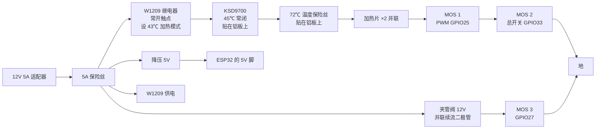

样机包 v0.1 · 2026-11-12 · 输液加温监控一体机

# 样机制作与测试指南

按这份指南可以买齐零件、加工铝板、接线、烧录程序,然后一步步测到整机联网运行。全程用水或生理盐水测试。这是功能样机,不是可以用在病人身上的产品。

## 1. 包里有什么,哪些已经验证过

| 内容 | 位置 | 验证情况 |
| --- | --- | --- |
| 服务器 + 配液端 + 护士站大屏 + 床旁屏 | `server/` | 已实际运行。全流程自测 27 项通过(下发、限温、核对、开始、远程调速待确认、暂停、滴空截停、结束、留痕),三个页面在浏览器里看过 |
| 设备模拟器 | `server/simulator.py` | 已实际运行。没有硬件时用它演示整套软件 |
| 固件判定逻辑(滴空、堵管、过温、报警、板温上限) | `firmware/include/logic.h` | 已在电脑上编译并跑单元测试,40 项通过 |
| 固件硬件驱动(测温、称重、数滴、夹管阀、加热、联网) | `firmware/src/main.cpp` | 已用 PlatformIO 编译通过(ESP32 Arduino 3.3.12,程序占 40%,内存占 16%)。没有在真实硬件上运行过 |
| 三维模型 8 件(STEP + STL) | `cad/out/` | 已生成,实体有效。上下铝板合模后槽与孔的对齐已用程序校验,槽内管长 601 mm。没有实际加工或打印过 |
| 电路 | 本页第 4 节接线表 | 没有画定制电路板。样机用现成模块接线,见下面说明 |

> “编译通过”只说明程序语法和库接口正确。引脚接法、传感器读数、夹管阀动作这些只有接上硬件才能验证,所以第 7 节的测试从最基础的上电自检开始,一步一步往上加。

### 和最终成品的差别

- **屏幕:** 主控盒正面是一块 7 英寸电容触摸屏,由盒内的树莓派驱动,开机后全屏显示服务器上的床旁页面(`kiosk/setup-kiosk.sh` 设置开机自启)。触摸屏只负责显示和操作,断网时会停在最后的画面;指示灯、蜂鸣器、暂停键、消音键直接接在 ESP32 上,屏幕黑了也照常报警和截停。成品应把界面做进嵌入式固件,不依赖网络。
- **电路板:** 我没有办法在不接触硬件的情况下保证一块定制电路板一次可用,所以这一版用开发板加现成模块搭。接线表就是完整的原理图网表,样机测通后可以交给电路板设计人员照此画板。
- **自动调速:** 样机不自动调流速。屏幕上改的是“设定流速”,护士手调滚轮夹,屏幕显示实测值和偏差,偏差过大报警。自动截停是有的。
- **电池:** 样机先用 12 V 适配器供电。电池和充电管理建议买带认证的成品电池包,在整机测通后再加。
- **安全等级:** 样机用单颗 ESP32。成品应按总方案改成安全主控和界面主控两颗芯片。

## 2. 采购清单

价格是粗略估计,仅用于预算。括号里是购物网站上可以搜的关键词。

| # | 零件 | 规格 | 数量 | 约价 元 |
| --- | --- | --- | --- | --- |
| 1 | 主控板 | ESP32-DevKitC(ESP32-WROOM-32,38 脚) | 1 | 25 |
| 2 | 模数转换 | ADS1115 16 位 I2C 模块 | 1 | 15 |
| 3 | 测温 | 10 kΩ B3950 1% NTC,Ø2 mm 环氧或玻封探头带线 | 5 | 15 |
| 4 | 精密电阻 | 10 kΩ 0.1% | 5 | 5 |
| 5 | 称重 | 5 kg 条形称重传感器 + HX711 模块 | 1 | 20 |
| 6 | 滴斗传感 | 5 mm 940 nm 红外发射管 + 5 mm 光电三极管 | 各 2 | 5 |
| 7 | 截停 | 12 V 常闭电磁夹管阀,适用外径 4 mm 软管(“常闭 夹管阀 12V”) | 1 | 60–150 |
| 8 | 功率开关 | MOS 管驱动模块(3.3 V 逻辑可驱动,≥5 A) | 3 | 15 |
| 9 | 加热片 | 聚酰亚胺薄膜加热片 12 V 15 W,约 50×150 mm,带背胶 | 2 | 30 |
| 10 | 独立过温保护 | XH-W1209 数显温控模块(12 V,带继电器和探头) | 1 | 10 |
| 11 | 机械过温保护 | KSD9700 常闭 45 ℃ 温控开关;72 ℃ 温度保险丝 | 各 2 | 10 |
| 12 | 触摸屏 | 树莓派官方 7 英寸触摸屏(800×480,电容触摸,DSI 接口;玻璃 193×111,可视区 154×86) | 1 | 450 |
| 12b | 屏幕主机 | 树莓派 4B(2 GB 即可)或 3B+;16 GB 以上 TF 卡;DSI 排线随屏附带 | 1 | 350 |
| 13 | 声光 | 有源蜂鸣器模块(高电平触发);5 mm LED 红黄绿;330 Ω 电阻 | 1 套 | 8 |
| 14 | 按键 | 16 mm 和 12 mm 面板自复位按键 | 各 1 | 10 |
| 15 | 合盖检测 | 干簧管 + 小磁铁 | 1 | 3 |
| 16 | 电源 | 12 V 6 A 适配器;12 V 转 5 V 3 A 降压模块 2 个(ESP32 和树莓派各用一个,互不拖累);7.5 A 保险丝座 | 1 套 | 70 |
| 17 | 连接器与线 | GX16-8 芯航空插头座 1 对,GX12-4 芯 3 对,DC 座,8 芯硅胶线 1.5 m,续流二极管 1N5819 | 1 套 | 50 |
| 18 | 保温 | 3 mm 气凝胶毡或闭孔泡棉;内径 4–5 mm 泡棉管 25 cm | 1 | 20 |
| 19 | 安装 | 输液架万向夹(抱杆夹);M5 吊钩;M3、M4、M5 螺丝 | 1 套 | 40 |
| 20 | 扫码 | USB 扫码枪(键盘模式),插在树莓派上 | 1 | 80 |
| 21 | 铝板加工 | CNC 两片,见第 3 节 | 1 副 | 200–400 |
| 22 | 3D 打印 | 6 件,PETG | 1 套 | 100–200 |

测试还需要:经计量的温度计、T 型细热电偶和记录仪、电子天平、输液泵(病房借用)、生理盐水和输液器。详见[加温台架试验方案](https://claude.ai/artifact/J8TDARWF1K3te7iFerLjdk)第 3 节。

## 3. 加工与打印

| 文件(cad/out/) | 做法 | 说明 |
| --- | --- | --- |
| `01_plate_lower_AL6061.step` | CNC,6061 铝 | 下板。4 个 Ø2.5 孔攻 M3。侧面 2 个 Ø2.2 深 20 测温孔 |
| `02_plate_upper_AL6061.step` | CNC,6061 铝 | 上板,与下板镜像。4 个 Ø3.4 通孔。侧面 1 个测温孔 |
| `03/04_heater_shell_*.stl` | 3D 打印 PETG | 加温模块上下壳。铝板面比壳口高约 0.3 mm,保证两片铝板直接贴合 |
| `05_drip_sensor_clip.stl` | 3D 打印,黑色 | 卡在滴斗中部。默认孔径 17 mm,先量你们的滴斗外径,不合适就在三维查看器里改“滴斗外径” |
| `06_loadcell_mount.stl` | 3D 打印,100% 填充 | 称重传感器固定座。固定端 2×M5,另一端悬空挂钩 |
| `07/08_control_box_*.stl` | 3D 打印 | 主控盒和盖。盖上开了 7 英寸触摸屏可视窗(155×87)、3 个 LED、2 个按键、蜂鸣器孔;触摸屏玻璃从盒内用 3M VHB 双面胶贴在盖板背面;侧面 5 个接口孔 |

- 给 CNC 厂的要求:槽用 R2 球头刀,槽面 Ra ≤1.6,槽口去毛刺,合模面平面度 0.05。台架阶段不做阳极氧化。
- 下单前先量输液管外径。槽按外径 4.1 mm 设计,偏差大时在三维查看器里改“单片槽深”。
- 发给加工厂:图纸在 `cad/drawings/IW-drawings.pdf`(每个零件一张 A3,含孔表、公差和技术要求),二维线稿在 `cad/drawings/dxf/`,三维模型在 `cad/out/`。图纸由脚本生成,下单前请加工厂确认。
- 看模型和改尺寸:`pip install cadquery reportlab ezdxf` 后在 `cad` 下运行 `python studio.py`,浏览器打开 `http://127.0.0.1:8095`。可以旋转、剖切、拖滑块改尺寸,点“保存并导出”后全部 STEP、STL 和铝板加工图按新尺寸重新生成。
- 主控盒只是一个能装下模块的起点,模块的固定位置需要你们按实物在盒底打孔或贴双面胶。

## 4. 接线

### 电源与加热回路



加热电流要依次通过四道关卡才能到加热片:W1209(独立电子保护,43 ℃ 断开,自身断电也断开)、KSD9700(机械保护)、温度保险丝(一次性)、两只由程序控制的 MOS 管。任何一道断开,加热即停。

### 信号接线表

| ESP32 引脚 | 接到 | 说明 |
| --- | --- | --- |
| 3V3 | ADS1115 VDD、HX711 VCC、所有 NTC 上端、ADS1115 A3 | A3 直接量 3.3 V 电源,用作比例测量基准 |
| GND | 所有模块地、12 V 电源负极 | 必须共地 |
| GPIO21 / 22 | SDA / SCL | ADS1115(地址 0x48,ADDR 接地) |
| ADS A0 | 板温 NTC 1(控制)分压点 | 每路:3.3 V — NTC — 分压点 — 10 kΩ 0.1% — 地。分压点对地并 100 nF |
| ADS A1 | 板温 NTC 2(保护)分压点 |
| ADS A2 | 出口管壁 NTC 分压点 |
| GPIO36 | 环境 NTC 分压点 | 同样的分压接法。探头放在药袋附近 |
| GPIO16 / 17 | HX711 DT / SCK | 称重传感器四线接 HX711 的 E+ E− A+ A− |
| GPIO26 | 150 Ω → 红外发射管正极,负极接地 | 约 13 mA |
| GPIO34 | 光电三极管集电极;集电极另经 10 kΩ 上拉到 3.3 V,发射极接地 | 发射管和接收管在滴斗夹里正对 |
| GPIO25 | MOS 1 信号 | 加热 PWM。栅极对地 10 kΩ 下拉(模块一般自带) |
| GPIO33 | MOS 2 信号 | 加热总开关 |
| GPIO27 | MOS 3 信号 | 夹管阀。通电打开,断电夹闭 |
| GPIO14 | 蜂鸣器模块信号 |  |
| GPIO18 / 23 / 19 | 红 / 黄 / 绿 LED,各串 330 Ω 到地 |  |
| GPIO32 | 暂停键,另一端接地 | 输液中按一下暂停,暂停时按一下恢复,完成后按一下结束 |
| GPIO13 | 消音键,另一端接地 |  |
| GPIO35 | 干簧管一端,另一端接地;GPIO35 经 10 kΩ 上拉到 3.3 V | 磁铁装在上壳。不装时把 config.h 里 HAS_LID_SWITCH 设 0 |

**触摸屏和树莓派:** 树莓派用第二个 5 V 降压模块单独供电(接 5V 和 GND 脚,或 USB-C 口),触摸屏用 DSI 排线接树莓派,屏的 5 V 和 GND 用附带的杜邦线接树莓派的 5V、GND 脚。树莓派和 ESP32 之间不接线,两者都连同一个 Wi-Fi,通过服务器交换数据。单机测试时也可以把 `server.py` 直接跑在这块树莓派上,ESP32 的 `SERVER_URL` 填树莓派的地址。

### 加温模块 8 芯线缆

加热正、加热负(各用 2 芯并联也可以,电流 2.5 A);NTC 1、NTC 2、出口 NTC 各 1 芯 + 公共 3.3 V 1 芯;干簧管 1 芯 + 地 1 芯。W1209 的探头单独走线插进上板的测温孔。KSD9700 和温度保险丝贴在下板外侧,串在加热正线里。

> 两只板温 NTC 插进下板的两个测温孔,孔里填导热硅脂,孔口点胶固定。这两只读数相差超过 1.5 ℃ 程序会判传感器故障,所以两只都要插到底。

## 5. 烧录固件

1. 安装 VS Code 和 PlatformIO 插件,或命令行 `pip install platformio`。
2. 打开 `firmware`,编辑 `include/config.h`:填 Wi-Fi 名称和密码、服务器电脑的 IP、设备编号。
3. 用 USB 线连接 ESP32,运行:

```
pio run -t upload
pio device monitor
```

在 Windows 上请把 `firmware` 文件夹放到很短的路径下(例如 `D:\iw\firmware`)。我在一个很深的文件夹里第一次编译时,因为 Windows 路径长度限制而安装库失败,换到短路径后通过。

串口里输入 `help` 可以看到全部测试命令。**第一次上电不要接加热片和夹管阀** ,先做下面的 T1–T3。

## 6. 运行服务器

任意一台装了 Python 3.9 以上的电脑,和设备在同一个 Wi-Fi 下。不需要安装任何依赖。

```
cd server
python server.py
```

- 配液端:`http://电脑IP:8080/pharmacy`
- 护士站大屏:`http://电脑IP:8080/ward`
- 床旁屏(平板上打开):`http://电脑IP:8080/bedside?dev=IW-001`
- 没有硬件时先看效果:另开一个窗口运行 `python simulator.py http://127.0.0.1:8080 4 20`,会出现 4 台模拟设备,时间加速 20 倍。
- 自测:`python test_flow.py`,最后一行应为 ALL PASS。

设备第一次上线会出现在大屏上显示“未绑定”,在那里填床号绑定。药品加温上限表在 `server.py` 顶部的 `DRUGS`,现在是演示数值,必须由药剂科审核后替换。

> 样机服务器没有登录和加密,页面也没有对输入做转义。只能在单独的测试网络里用,不要接入医院业务网,不要录入真实病人信息。

## 7. 整机分步测试

加温台架试验已经并进来:T6、T7 就是原方案的 S2、S3,用同一套整机硬件完成,不需要另搭台架。每一步通过再做下一步。串口命令在 `pio device monitor` 里输入。

| 步骤 | 内容 | 做法 | 通过标准 |
| --- | --- | --- | --- |
| T1 | 上电自检 | 不接加热片和夹管阀。上电,输入 `status` | `ads=1`;三路温度接近室温;红黄绿灯和蜂鸣器不乱响 |
| T2 | 温度校准 | 所有 NTC 和 W1209 探头捆在一起,放入 37 ℃ 和 41 ℃ 水中,与精密温度计比对。偏差填进 config.h 的 OFFSET_ 项后重新烧录。W1209 用 P4 参数修正,设为加热模式 43.0 ℃、回差 2 ℃ | 校准后各路与标准温度计相差 ≤0.2 ℃;水温升到 43 ℃ 时 W1209 继电器断开 |
| T3 | 称重 | 空钩 `tare`;挂 500 g 砝码(或一袋称过的盐水)`cal 500`;再挂 100、250 g 核对 | 误差 ≤2 g |
| T4 | 数滴 | 装好输液器和滴斗夹,重力滴注。`raw 1` 看信号,液滴经过时 raw 与 base 之差应远大于 noise;据此调 config.h 的 DROP_MIN_DELTA。分别在约 20、60、120 滴/分下人工数 100 滴,与 `status` 里的 drops 比较 | 100 滴误差 ≤2 滴;关灯、开灯、手电照射下都不误计 |
| T5 | 夹管阀 | 接上夹管阀。药袋挂 1 m 高,滚轮夹全开。`clamp 1` 应流,`clamp 0` 应停。保持 `clamp 1` 1 小时后摸阀体 | 夹闭时 5 分钟内一滴不漏;阀体表面 ≤50 ℃;拔掉电源立即夹闭 |
| T6 | 加热空载 | 接上加热回路,管内充水不流动。`log 1`,`plate 41` | 到 40 ℃ ≤5 分钟;过冲 ≤0.5 ℃;稳定后两只 NTC 相差 ≤0.5 ℃;任何时刻板温 ≤41.5 ℃ |
| T7 | 稳态换热(核心) | `plate 41`。输液泵依次 60、120、250、500 mL/h,在进口、出口、出口后 25 cm 三处用热电偶测液温。做法和记录表见台架方案 S2、S3 | 250 mL/h 出口 ≥39 ℃;500 mL/h 出口 ≥37 ℃;换热能力 UA ≥0.75 W/K。把实测 UA 填进 config.h |
| T8 | 外表面温度 | `plate 41` 稳定 30 分钟,测外壳各处、线缆出口、裸露的铝板边缘 | 外壳 ≤38 ℃;任何手能碰到的地方 ≤41 ℃ |
| T9 | 单机完整输液 | 挂一袋 250 mL 盐水,滚轮夹调到约 40 滴/分。`start 250 120 37 20`。运行中对比:屏幕流速与天平称得的流速;屏幕余量与实际 | 流速误差 ≤10%;余量误差 ≤10 mL;穿刺点液温 37±1 ℃ |
| T10 | 滴空自动截停 | 接 T9,让它一直输到袋空 | 余量不足时黄灯预警;停滴 20 秒内夹管阀夹闭、红灯、蜂鸣器急促响;此时滴斗下方管路里仍充满液体,没有进气 |
| T11 | 故障注入 | 输液中分别:(a) 用手捏死管路 (b) 把滚轮夹突然全开 (c) 打开加温盖 (d) 拔掉一只板温 NTC (e) 拔电源 (f) 关掉 Wi-Fi | (a) 约 20 秒后截停并报“不滴” (b) 15 秒后截停并报“流速失控” (c) 停止加热并报警,输液继续 (d) 停止加热并截停 (e) 夹管阀立即夹闭 (f) 设备照常工作,OLED 显示断网 |
| T12 | 失控加热 | 管内不流动。把 MOS 1 和 MOS 2 的输出端直接短接到地,让加热片全功率常开。人不要离开 | W1209 在 43–44 ℃ 断开;板温峰值 ≤46 ℃。再把 W1209 也短接:KSD9700 应在约 45–50 ℃ 断开 |
| T13 | 联网全流程 | 启动服务器。配液端下发任务 → 平板床旁屏扫腕带和药袋码 → 确认开始 → 大屏查看 → 大屏点暂停 → 床旁恢复 → 大屏请求调速 → 床旁确认 | 每一步两边显示一致;大屏暂停后 3 秒内夹管阀夹闭;调速在床旁确认前不生效;腕带或药袋码不符时不能开始 |
| T14 | 多台与断线 | 真机 + 模拟器 4 台同时运行 2 小时;中途关掉服务器 5 分钟再打开 | 大屏显示离线;设备输液和报警不受影响;服务器恢复后自动重连 |
| T15 | 擦拭消毒 | 75% 乙醇湿巾擦拭外壳和加温槽 200 次 | 无开裂、发白、字迹脱落;功能正常 |

> T12 是故意让加热失控的试验。旁边不放易燃物。板温超过 60 ℃ 保护仍未动作时立即拔电源,并检查 W1209 和 KSD9700 的接线。

## 8. 关于烫伤和安全

- **正常工作时最热的地方就是铝板本身,41 ℃。** 它被 3 mm 保温层和塑料外壳包在里面。外壳表面估计 30–35 ℃,比体温低。T8 会实测。
- **单一故障时:** 程序在 42 ℃ 锁定停止加热;W1209 在 43 ℃ 独立切断;KSD9700 在约 45 ℃ 机械切断;温度保险丝 72 ℃ 兜底。T12 会实测板温峰值。
- **对药液:** 加热面不超过 41 ℃,所以即使流速降到零,管里的药液也不会超过 41 ℃。单元测试已验证程序在任何流速、目标和环境温度组合下给出的板温设定都不超过 41 ℃。
- **电气:** 加温模块和线缆上只有 12 V 低压。样机适配器是普通适配器,成品必须换成符合 GB 9706.1 的医用适配器。
- **断电和死机:** 夹管阀断电即夹闭。程序卡死 5 秒看门狗复位,复位后加热关闭、夹管阀夹闭。

以上是按医用电气安全标准的思路做的设计,不等于达标。是否符合 GB 9706.1 等标准,只能由有资质的检测机构对实物做型式检验后才能下结论。

## 9. 已知的风险点

- 夹管阀能否把较硬的 PVC 输液管夹死,要看买到的型号,T5 不通过就换夹持力更大的型号或在夹口处换一小段硅胶管。
- ESP32 自带模数转换精度有限,滴斗信号的阈值需要按 T4 实际调整。
- 药袋晃动会干扰称重。程序用了 2 分钟线性回归来平滑,转运途中余量读数仍可能跳动。
- 袋装药液通常有 5–10% 的过量灌装,所以“余量”到 0 后还会再滴一会儿。滴空判定要求停滴和余量低同时成立,不受这个影响。
- 出口管壁温度(NTC 3)目前只记录,不参与控制。到达温度是按模型估算的,T7 实测后需要用数据修正模型里的 UA 和散热系数。
