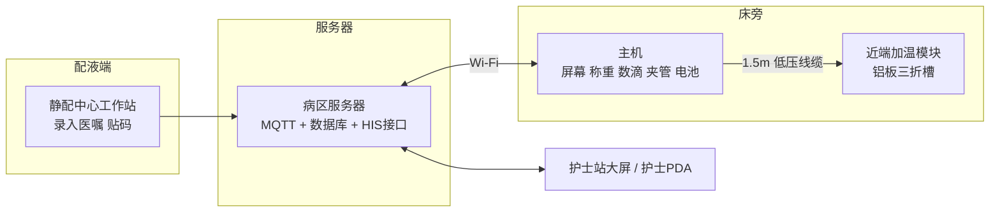
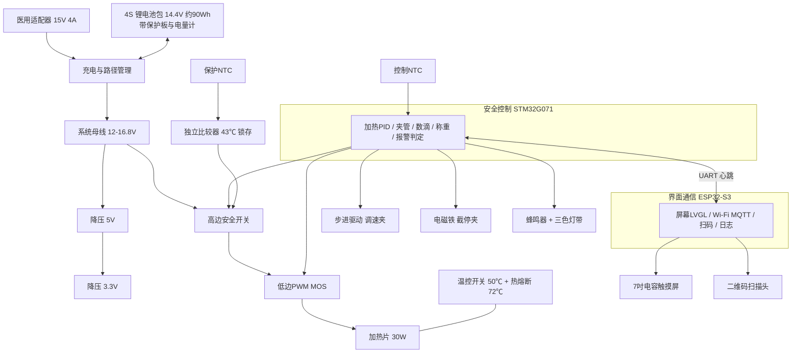
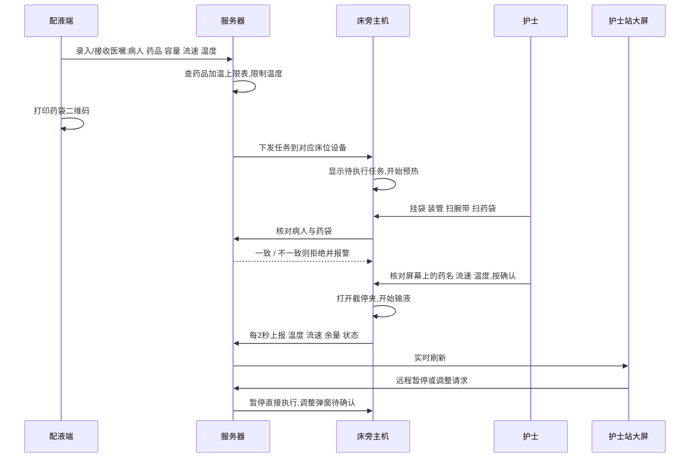

设计方案 v0.1 · 2026-11-12 · 供外科临床讨论与样机试制

# 输液加温监控一体机

一台挂在输液架上的主机负责称重、测滴速、调速、截停和显示,一个放在病人手边的干式加温模块负责把药液加到设定温度。配液端下发任务,护士床旁扫码确认,护士站大屏同步显示并可远程操作。

## 先说结论

**不做水浴箱,做干式加温** 水浴有储水、易滋生细菌、怕倾倒、消毒困难。干式铝板夹住输液管加热,药液不接触设备,外表面一擦即可。

**加温模块放在病人手边** 病房输液流速低,药液在加温器之后的管路里会很快凉掉。文献实测 100 mL/h 时 37 ℃ 的液体流过 105 cm 管路只剩 24.4 ℃。所以加温点必须离穿刺点 25 cm 以内。

**默认 37 ℃,可调 33–41 ℃** 加热面硬上限 41 ℃,这样即使停流,管内药液也不可能超过 41 ℃。独立硬件在 43 ℃ 切断加热。

**直接用普通输液器,无专用耗材** 把输液器末段 60 cm 管路压进铝板的三折槽里,合盖即可。不需要螺旋管耗材,也没有新增的药液接触材料。

**称重 + 滴速双重测流量** 挂钩称重算余量和剩余时间,红外数滴算瞬时流速,两者互相校验。步进夹管调速,弹簧常闭夹断电自动截停。

**远程操作分两级** 护士站可以直接暂停和消音。调流速、调温度这类会增加风险的指令,只在床旁屏幕弹出,护士在床旁确认后才执行。

> 使用场景已确认为**病房/输液室** (流速通常 ≤250 mL/h)。本方案的近端加温模块加温能力到 500 mL/h,留有一倍余量。第 4 节末尾的鼓式大流量模块不在首版范围内,仅作为今后扩展到手术室的备选。

## 1. 文献依据:加到几度

- **目标 37 ℃。** NICE 围术期低体温指南(CG65)建议 ≥500 mL 的静脉液体和血制品用加温装置加到 37 ℃。
- **上限 41–43 ℃。** 市售加温器(3M Ranger、国产 BK-TW 系列等)设定范围普遍是 33–41 ℃。血液类产品说明书把 43 ℃ 以上列为溶血风险,AABB 血库标准以 42 ℃ 为上限。本机不超过 41 ℃,留出余量。
- **低流速是难点。** Faries 等(1991)测得 100 mL/h 时 37 ℃ 液体经 105 cm 输液管降到 24.4 ℃。Kim 等(2020)对比 Hotline 和 S-line,结论相同:100 mL/h 时多走 90 cm 延长管就明显失温。
- **铝不能接触药液。** enFlow 加温器的裸铝加热板直接接触药液,2019 年被英国 MHRA 警示铝溶出。本方案药液始终在 PVC 输液管内,铝板只接触管外壁。
- **不是所有药都能加温。** 部分抗生素、生物制剂、脂肪乳、胰岛素等对温度敏感。配液端要维护一张“药品可加温上限”表,下发任务时自动限制温度或禁用加温。这张表需要医院药剂科确认,不能由设备厂商自定。

> 临床价值要实事求是:1 L 室温晶体液大约使 70 kg 成人平均体温下降 0.25 ℃,所以加温对大量快速输液意义明确。病房里 60–120 mL/h 的慢速输液,加温带来的热量只有 1–2 W,对核心体温影响很小,主要价值是减轻冷刺激、血管痉挛和寒战不适。

## 2. 市面上已有什么

| 类型 | 代表产品 | 原理 | 对本项目的启示 |
| --- | --- | --- | --- |
| 干式板式 | 3M Ranger、国产 BK-TW110/210、百润 | 专用加温袋/盒夹在两块加热板间,33–41 ℃ | 大流量好用,但需专用耗材,加温器在架子上,低流速到病人端已凉 |
| 水浴逆流 | Smiths Hotline | 三腔管,循环温水包着药液一直到病人端 | 低流速效果最好,证明“加热到末端”是对的。但有水箱,要换水和消毒 |
| 近端干式 | enFlow、Buddy Lite | 小型一次性加热盒放在病人手边 | 位置对,但药液接触加热板,有铝溶出教训,且耗材贵 |
| 加热套管 | Barkey S-line/autoline | 硅胶加热套裹住普通输液管 | 无耗材、无失温,是很好的思路。定制硅胶挤出件试制难度高,列为二代方案 |
| 输液监控 | 多家国产“智能输液监控系统” | 红外数滴或称重,LoRa/Wi-Fi 上传护士站,部分带夹管 | 功能成熟,已有三家医院临床试验报道。但没有和加温、配液任务打通 |

没有检索到把“加温 + 流速闭环 + 配液任务下发 + 大屏联动”做在一套系统里的成熟产品。这是本方案的差异点,也意味着注册时没有完全对应的同类品可比。

## 3. 总体架构

主机抱在输液架或床栏上,药袋挂在主机自带的称重杆上,整套可以随病人一起移动。

## 4. 加温模块

### 形状与材料

- **外形:** 翻盖式扁条,约 200 × 64 × 22 mm,重约 400 g,用魔术贴或床单夹固定在病人手边。
- **加热体:** 上下两片 6061 铝合金,硬质阳极氧化。合模面铣出三折 U 形槽,槽径 4.2 mm(对应外径 4.1 mm 的标准 PVC 输液管),转弯半径 12 mm 防折管。槽内管长 **0.6 m** 。
- **加热元件:** 两片聚酰亚胺薄膜加热片贴在铝片背面,各 12 V 15 W,合计 30 W。由 22 ℃ 预热到 41 ℃ 约 3 分钟。
- **保温与外壳:** 加热片外侧 3 mm 气凝胶毡,外壳 PC/PBT 合金。外表面温度不超过 41 ℃,可以贴着皮肤。
- **出口到穿刺点:** 一段 25 cm 的闭孔硅胶泡棉保温套(可擦拭,随机配)。
- **传感器:** 铝板内两只独立 NTC(控制用一只,保护用一只),出口管夹内一只 NTC 贴管壁估算出液温度,霍尔开关检测合盖,光电检测管路在位。

装管方法:开盖,把输液器末段按 S 形压入槽内,合盖,扣上锁扣。约 15 秒。

### 热学计算

药液在细管里是层流,换热瓶颈在 PVC 管壁(导热系数约 0.17 W/m·K)。按管内径 3.0 mm、壁厚 0.55 mm、全周贴合估算,每米管长的传热能力约 1.6 W/K,0.6 m 合计约 0.96 W/K。进液按 22 ℃ 计。

| 流速 mL/h | 加到 37 ℃ 所需功率 | 出口最高可达 (板温 41 ℃) | 到穿刺点温度 本方案 | 到穿刺点温度 加温器在架上,1.2 m 裸管 |
| --- | --- | --- | --- | --- |
| 60 | 1.0 W | 41.0 ℃ | 37 ℃ | 约 24 ℃ |
| 120 | 2.1 W | 41.0 ℃ | 37 ℃ | 约 27 ℃ |
| 250 | 4.4 W | 40.3 ℃ | 37 ℃ | 约 31 ℃ |
| 500 | 8.7 W | 37.4 ℃ | 37 ℃ | 约 34 ℃ |
| 750 | 13.1 W | 34.7 ℃ | 约 34.6 ℃ | 约 35 ℃ * |
| 1000 | 17.4 W | 32.7 ℃ | 约 32.6 ℃ | 约 35 ℃ * |

* 假设架上加温器出口能维持 37 ℃。以上全部是理论估算,没有做过台架实测。接触热阻、管材差异都会影响结果,样机第一件事就是用恒流泵和热电偶把这张表实测一遍。

结论:本模块在 **500 mL/h 以内** 能把药液以 37 ℃ 送到穿刺点,覆盖病房绝大多数输液。低流速下控制器会把板温略微调高(不超过 41 ℃)来补偿最后 25 cm 的散热。

### 大流量选配:鼓式加温模块

手术室场景换成这个模块:直径 60 mm 的铝鼓,外圆车出螺旋槽,把输液管绕 7 圈(管长约 1.3 m),外面合上带硅胶衬的保温盖,加热功率 60 W。估算 1000 mL/h 时出口约 36–37 ℃。它需要多占 1.3 m 管路,所以要配延长管。这就是“螺旋管”的思路,只是螺旋做在设备上,管子仍用普通输液管。

## 5. 流速监测、调速与截停

| 功能 | 实现 | 说明 |
| --- | --- | --- |
| 余量与剩余时间 | 挂袋杆底部 5 kg 称重传感器 + 24 位 ADC | 分辨率约 1 g(1 mL)。扫码时得到初始容量,皮重自动扣除。剩余时间 = 余量 ÷ 近 2 分钟平均流速 |
| 瞬时流速 | 滴斗两侧双光束 940 nm 红外对管,38 kHz 调制抗环境光 | 数滴 × 输液器滴系数(15/20/60 滴每 mL,扫码或手选)。用称重斜率自动修正滴系数误差 |
| 流速调节 | 微型步进直线电机推动压块挤压输液管 | 以滴速为反馈的慢速 PI 闭环,每 10 秒修正一次,精度目标 ±10% |
| 截停 | 弹簧常闭夹,5 V 保持电磁铁吸合时打开 | 断电、主控死机、开门、报警时电磁铁释放,弹簧夹闭。与调速夹相互独立 |
| 滴空 | 连续 20 秒无液滴,且称重余量低于阈值 | 两个条件同时满足才判滴空并截停,避免误报。余量 <5% 时先预警 |
| 堵管/不滴 | 夹已打开但超过 20 秒没有液滴(慢速时为 4 个滴间隔),余量仍充足 | 截停并报警,护士检查后在床旁恢复。停滴后尽快夹闭可以避免回血凝管 |
| 气泡(选配) | 加温模块出口处超声气泡传感器 | 加温会让溶解气体析出成小气泡,建议二期加上 |

> 自动调速使本机在法规上接近“输液控制器”,要求比单纯监测高很多。建议分两步:第一版只做监测、报警和截停,调速由护士手拧滚轮夹,设备提示偏差。闭环调速放到第二版。

## 6. 电路与控制芯片

### 为什么用两颗芯片

加热和夹管是安全相关功能,不能因为屏幕卡顿或 Wi-Fi 重连而受影响。STM32 只做实时控制和报警,代码量小,便于验证。ESP32-S3 负责界面和联网。两者互发心跳,任一方 2 秒无应答,STM32 关加热并截停。

### 过温三重保护

1. 软件:STM32 的 PID 把板温限制在 41 ℃,到 42 ℃ 报警停止加热。
2. 硬件:独立比较器读取第二只 NTC,43 ℃ 时锁存切断高边开关,不经过任何软件,断电重启才能复位。
3. 机械:串在加热回路里的 50 ℃ 温控开关和 72 ℃ 一次性热熔断器。

另外两只 NTC 读数相差超过 1.5 ℃ 即判传感器故障并停止加热。

### 主要器件清单

| 部分 | 器件(型号为示例,同类可替换) | 要点 |
| --- | --- | --- |
| 安全主控 | STM32G071RBT6 | 12 位 ADC,独立看门狗,可用 ST 的 Class B 自检库 |
| 界面主控 | ESP32-S3-WROOM-1 N16R8 | RGB 屏接口,Wi-Fi/BLE,LVGL 界面 |
| 屏幕 | 5.0 吋 IPS 800×480 电容触摸,全贴合玻璃盖板 | 戴手套可操作,表面耐酒精擦拭 |
| 温度 | 医用级 10 kΩ NTC ±0.1 ℃ ×3,环境温度 TMP117 | 玻封或环氧封装,导热胶灌封进铝板 |
| 加热驱动 | 高边 P-MOS + 低边 N-MOS,1 kHz PWM,INA180 测电流 | 电流回读用于发现加热片开路或 MOS 击穿 |
| 硬件过温 | LMV393 比较器 + 锁存 | 独立供电基准 |
| 称重 | 5 kg 铝合金称重传感器 + NAU7802 | 机械限位防过载 |
| 数滴 | 940 nm 红外发射管 + 光电三极管 ×2 对 | 38 kHz 调制,同步解调 |
| 调速夹 | Ø8–10 mm 步进直线电机 + TMC2209 | 堵转检测做零位 |
| 截停夹 | 5 V 保持式电磁铁 + 不锈钢弹簧夹 | 吸合后降压保持,功耗约 0.5 W |
| 电源 | 医用适配器(IEC 60601-1,2×MOPP)15 V 4 A;BQ25713 充电;已认证的 4S 智能电池包 | 电池包和适配器买有医疗认证的成品,不要自己拼 |
| 扫码 | 嵌入式二维码扫描模组 | 扫腕带和药袋标签 |
| 声光 | 压电蜂鸣器 ≥65 dB,顶部环形三色灯带 | 报警声光符合 YY 9706.108 的优先级编码 |
| 加温线缆 | 1.5 m 硅胶护套 8 芯,推拉自锁医用连接器 | 加热 2 芯,NTC 4 芯,合盖与在位 2 芯 |

**续航估算:** 屏幕和主控约 3 W,加热在 120 mL/h 时平均约 5 W(含散热损失),电磁铁 0.5 W。90 Wh 电池约可用 9–10 小时。样机单台物料成本粗估 2000–3000 元,不含模具。

### 控制逻辑

- **温度:** 用户设定的是“到达病人的药液温度”。控制器根据当前流速和环境温度算出需要的板温(前馈),再用出口管壁 NTC 做慢速修正,板温始终夹在设定值和 41 ℃ 之间。
- **停流:** 流速为零时板温降到设定值保温,不再前馈加高。恢复流动后自动回升。
- **状态机:** 待机 → 已接收任务 → 扫码核对 → 预热 → 护士确认开始 → 输液中 ⇄ 暂停 → 完成/滴空截停 → 待机。

### 报警表

| 级别 | 条件 | 设备动作 |
| --- | --- | --- |
| 高 | 板温 ≥42 ℃、硬件过温触发、温度传感器故障 | 断加热,截停,红灯急促音,大屏置顶 |
| 高 | 滴空、堵管/不滴、气泡(选配)、自由流(滴速远超设定) | 截停,红灯,大屏置顶 |
| 中 | 流速偏差 >20% 持续 1 分钟、出液温度偏差 >2 ℃ 持续 3 分钟、加温盖打开 | 黄灯间歇音,不截停(加温盖打开时停加热) |
| 中 | 余量 <5% 预警、电量 <15%、与服务器失联 >1 分钟 | 黄灯提示,本机继续独立工作 |
| 低 | 电量 <5% | 先截停并提示,再关机 |

## 7. 箱体、安装与消毒

- **主机尺寸:** 约 190 × 125 × 60 mm,含电池约 900 g。挂袋杆不锈钢,高 320 mm,可折叠收纳。顶部提手。
- **安装:** 背面快拆抱杆夹,适配 Ø16–32 mm 输液架和床栏。底部四只硅胶脚垫,也可以平放在床头柜上。转运时主机、药袋、加温模块整套跟着病人走,电池供电不中断。
- **管路通道:** 在主机右侧,一扇透明门后面从上到下是滴斗槽、调速夹、截停夹。开门时截停夹自动夹闭,防止自由流。
- **外壳材料:** PC/PBT 合金。常见的 PC/ABS 长期被酒精擦拭会应力开裂,不建议用。屏幕为玻璃盖板。密封圈和按键用硅胶。
- **卫生设计:** 无风扇、无散热孔、无外露螺丝、无缝隙积液。目标防护等级 IP44。所有外圆角 R≥2 mm,加温槽为开放式 U 形,湿巾可以擦到底。接口带防护盖。
- **消毒:** 设备不接触药液和破损皮肤,属低度危险性物品。每位病人用后以 75% 乙醇、500 mg/L 含氯消毒剂或季铵盐湿巾擦拭,依据 WS/T 367 和 WS/T 512。样机阶段要做 1000 次以上擦拭的耐化学性试验。保温套为闭孔硅胶,同样可擦拭,隔离病人使用后更换。
- **不能做的:** 不能浸泡,不能高压灭菌,不能用于 MRI 室。

## 8. 屏幕界面与大屏联动

下面两块是可以点的样机。在右边大屏的 12 床上点“暂停”,左边床旁屏立即暂停。点“调速”,左边会弹出确认框,床旁确认后两边才更新。

> 这里原本是一个可以点的界面演示。实际界面请运行 `server/server.py` 后打开 `/ward`、`/bedside`、`/panel` 查看。

### 远程操作规则

| 操作 | 护士站/PDA 远程 | 床旁 |
| --- | --- | --- |
| 暂停(截停)、消音 | 直接执行,床旁屏显示“已由护士站暂停” | 直接执行 |
| 恢复输液 | 只能发起请求 | 必须在床旁确认 |
| 调高/调低流速、改温度 | 只能发起请求,床旁弹窗 | 护士确认后执行,超出医嘱范围需工号验证 |
| 开始新一袋输液 | 不允许 | 扫腕带 + 扫药袋,核对一致后确认 |

原因是远程看不到病人。往安全方向的操作(停)可以远程,往风险方向的操作必须有人在床旁。所有操作记录操作人、时间和前后数值。

## 9. 从配液到开始输液的流程

### 软件组成

- **设备固件:** STM32 用 C 写实时控制。ESP32-S3 用 ESP-IDF + LVGL 写界面,MQTT over TLS 联网,断网时本机功能完整,数据缓存后补传。
- **服务器:** 部署在医院内网。MQTT 消息服务(EMQX 或 Mosquitto)、业务服务(FastAPI 或 Spring Boot)、PostgreSQL。
- **网页端:** 配液端页面、护士站大屏页面、管理后台(设备、药品加温表、报警阈值、日志追溯)。
- **与医院系统对接:** 通过 HL7 或医院提供的视图/接口从 HIS 读取医嘱和病人信息。没有接口时,配液端可以手工录入,系统独立运行。
- **数据安全:** 设备屏幕和大屏上姓名脱敏,通信加密,每台设备独立证书,操作留痕。

## 10. 法规与标准

- 这是有源医疗器械,在病人身上使用前必须取得注册证。院内自制样机只能做台架试验和模拟测试。若做临床试验,需要走伦理和临床试验备案。
- 分类需要向药监部门申请界定。按我的理解,输液加温和输液监测一般按第二类管理,带自动调速的输液控制功能可能被归到更高类别。检索中还看到加温仪配套的一次性输液管路按第三类注册。这部分我没有查到确定依据,请以 NMPA 分类界定结果为准。
- 主要适用标准:GB 9706.1(电气安全)、YY 9706.102(电磁兼容)、YY 9706.108(报警系统)、GB 9706.224(输液泵和输液控制器,做闭环调速时适用)、GB/T 42062(风险管理)、YY/T 0664(医疗器械软件)、医疗器械网络安全注册审查指导原则。加温性能可参考已废止的 ASTM F2172 的试验方法。
- 近端加温模块会接触病人,按 BF 型应用部分设计,注意漏电流和外表面温度限值。

## 11. 样机路线与待验证项

| 阶段 | 内容 | 目的 |
| --- | --- | --- |
| A. 加温台架 | CNC 一副铝板 + 加热片 + 开发板,恒流泵打水,热电偶测出口和末端温度 | 实测第 4 节的温度表,确定管长够不够 |
| B. 测流台架 | 称重 + 数滴,和电子天平对比 | 确定流速和余量精度,调滴空判据 |
| C. 功能样机 | 3D 打印外壳,两块 PCB,屏幕界面,单机可用 | 给护士试操作,改装管和界面流程 |
| D. 联网 | 服务器、配液端、大屏,3–5 台设备联调 | 验证下发、确认、远程操作和断网行为 |
| E. 工程样机 | 开模外壳,安规和电磁兼容预测试,消毒剂耐受试验 | 为注册检验做准备 |

### 目前没有验证、需要实测或专业确认的地方

- 所有温度和功率数字都是计算值。
- 不同品牌输液器的管径和硬度不同,槽径公差和夹持力要实测。
- 夹管调速在 PVC 管蠕变下的长期稳定性。
- 加温后气泡析出的程度,决定气泡传感器是否必须。
- 药品可加温清单,需要药剂科提供。
- 产品分类和注册路径,需要咨询注册法规人员。

**参考来源**

1. [NICE CG65 Hypothermia: prevention and management in adults having surgery](https://www.nice.org.uk/guidance/cg65/chapter/1-guidance)
2. [Presson 等 1993,Hotline 与传统加温器在 50–12000 mL/h 的对比(含 Faries 1991 引用数据)](https://link.springer.com/article/10.1007/BF03020526)
3. [Kim 等,Hotline 与 S-line 低流速体外对比,BMC Anesthesiology](https://bmcanesthesiol.biomedcentral.com/counter/pdf/10.1186/s12871-020-01225-1.pdf)
4. [enFlow、Fluido compact、Thermosens 低流速对比](https://pmc.ncbi.nlm.nih.gov/articles/PMC6064623)
5. [MHRA MDA/2019/015 enFlow 铝溶出警示](https://assets.publishing.service.gov.uk/media/5c81252240f0b6368ff11464/MDA-2019-015_Final.pdf)
6. [3M Ranger 245 型操作手册(中文)](https://solventum.com/content/dam/public/language-masters/en/msb/document/2012/3M-Ranger-System-Model-245-Operators-Manual-Chinese.pdf)
7. [BK-TW110/210 输血输液加温器参数](https://appliedphysicsusa.com/products/blood-and-fluid-warmer)
8. [ThermaCyl 510(k) 摘要(42 ℃ 上限与 AABB 引用)](https://510k.innolitics.com/device/K953741)
9. [ASTM F2172-02 血液/输液/冲洗液加温器规范(已废止)](https://store.astm.org/f2172-02.html)
10. [智能输液系统设计与三家医院临床试验,《中国医学工程》2024](https://search.napstic.cn/literature/periodical/010zgyxgc202405003)
11. [基于重力传感的输液监控系统,《中国医疗器械杂志》2019](https://zgylqxzz.xml-journal.net/article/doi/10.3969/j.issn.1671-7104.2019.03.006)
12. [NMPA 医疗器械批准注册目录(含加温仪配套输液管路)](https://www.nmpa.gov.cn/directory/web/nmpa/images/1744615896524019746.doc)
